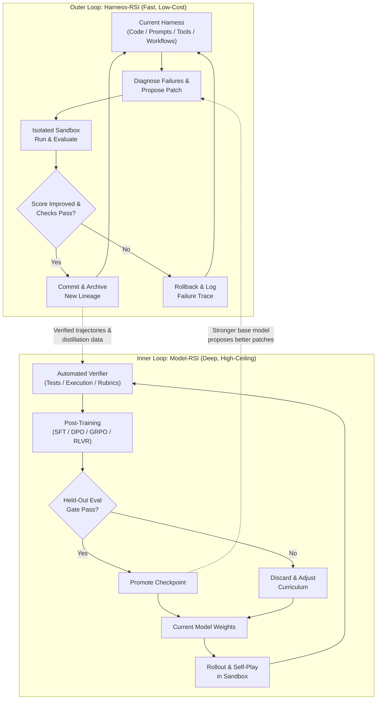

# OpenRSI

[](./LICENSE)
[](https://github.com/study8677/openrsi/stargazers)
[](https://github.com/study8677/openrsi/pulls)

**English** | [中文](./README_zh.md)

> An open-source **Recursive Self-Improvement (RSI)** engine — let your AI Agent rewrite its own code, verify in sandboxes, and evolve automatically.

OpenRSI explores how AI systems can improve themselves systematically, verifiably, and safely. Instead of treating "self-improvement" as a single vague concept, OpenRSI separates it into two complementary tracks:

1. **[Harness-RSI](./harness-rsi/README.md)** — Evolving everything *around* the model (agent code, prompts, tools, memory, workflows, and search strategies) while keeping model weights frozen.
2. **[Model-RSI](./model-rsi/README.md)** — Evolving the model's *internal weights* through self-generated trajectories, verifiable rewards, and automated post-training loops.

---

## Architecture Overview

Both tracks share the same core scientific loop: **Propose → Execute in Sandbox → Verify & Score → Gate & Archive**. Together, they form a dual-loop flywheel:



### Why the Dual-Loop Flywheel Matters

- **Harness-RSI feeds Model-RSI**: A stronger harness (better search, verification, and tool use) solves harder problems and produces high-signal, verified trajectories that can be distilled into model weights.
- **Model-RSI feeds Harness-RSI**: A stronger base model diagnoses subtle harness bugs more accurately and writes higher-quality code/prompt mutations in fewer iterations.

---

## Harness-RSI vs. Model-RSI

| Dimension | [Harness-RSI](./harness-rsi/README.md) | [Model-RSI](./model-rsi/README.md) |
| :--- | :--- | :--- |
| **What Evolves** | Agent source code, prompts, tools, memory, routing, search & planning logic | Neural network parameters (LoRA / full weights) |
| **Model Weights** | Frozen (works with closed APIs or open weights) | Updated via automated training loops (requires open weights) |
| **Iteration Cycle** | Minutes to hours | Hours to days |
| **Compute & Cost** | Low — API / inference cost + lightweight sandboxes | High — GPU cluster for rollouts + RL/SFT training |
| **Primary Methods** | Code self-editing, prompt optimization, tool synthesis, evolutionary archive (e.g., MAP-Elites) | Rejection sampling (STaR), RLVR (GRPO/PPO), DPO, self-play curriculum |
| **Rollback & Auditability** | Trivial — `git revert` and human-readable diffs | Heavier — checkpoint versioning and benchmark regression suites |
| **Main Failure Modes** | Overfitting to benchmark tests, reward hacking, brittle patches | Model collapse, catastrophic forgetting, reward hacking |
| **Best Starting Point** | **Start here** — fast feedback, transparent diffs, immediate utility | Build next — once verified tasks and harness trajectories exist |

---

## Design Principles

1. **Verifiable Progress Over Vibes**: Every self-modification must be judged by deterministic execution, unit tests, or strictly isolated evaluation suites—never by an ungrounded self-score alone.
2. **Immutable Evaluator, Mutable Target**: The agent is allowed to edit the target harness or generate training data, never the grading harness or held-out test set.
3. **Sandbox-First Safety**: All candidate code changes and model rollouts execute inside isolated sandboxes with strict resource, network, and time limits.
4. **Lineage & Archive Over Blind Greedy Hill-Climbing**: Keep a versioned tree of candidates so evolution can branch, backtrack, and preserve diverse solutions rather than collapsing into a local optimum.
5. **Reproducible & Open**: Every evolution run should emit inspectable traces, diffs, scores, and seeds.

---

## Verified Results (Harness-RSI MVP)

Using **zero extra API cost** (powered locally by `codex exec` via ChatGPT OAuth), OpenRSI automatically evolved context compactors from naive sliding-window baselines:

1. **OpenRSI Context-Compaction Arena (`14k–15k` tokens → `18%` budget, hidden `pytest`)**:
   - Baseline v0 (sliding window) → **`0.000`** on train & unseen held-out
   - RSI Gen 3 (auto-evolved deterministic extractor) → **`1.000` (8/8)** on train & **`1.000` (8/8)** on unseen held-out (`83.4%` compression)
2. **CompactBench Official Full `practice` Suite (Elite Difficulty — 48/48 cases, ~32k tokens, 8 adversarial families mixed, 4 drift cycles, 4,546 probes)**:
   - `OpenRSICompactor` v1 (`0.2.2`, Delta Ledger): `0.762 [95% CI: 0.740, 0.784]` (`3,535/4,546` full-credit)
   - `OpenRSICompactor` v2 (`0.2.4`, 2-Pass Audit): `0.767 [95% CI: 0.750, 0.785]` (`3,458/4,546` full-credit)
   - **`OpenRSICompactor` v2.5 (`0.2.5`, Protected Packer)**: **`0.806 [95% CI: 0.784, 0.829]`** (`3,624/4,546` full-credit, **+4.4 pts over v1 with non-overlapping 95% CI**, Cycle 0→4: `0.90 → 0.72`, drift resistance `0.803`, `0.0%` hallucination, `0` budget violations) — see full 48-case breakdown & charts in [`harness-rsi/reports/cb_leaderboard.md`](./harness-rsi/reports/cb_leaderboard.md).

---

## Repository Structure

```text
openrsi/
├── README.md                              # Project overview, architecture & results (EN)
├── README_zh.md                           # Project overview (ZH)
├── harness-rsi/
│   ├── README.md / README_zh.md           # Harness-RSI architecture & quickstart
│   ├── arena/
│   │   ├── fix-mini-kvstore/              # Harbor sandbox task (nop=0.0, oracle=1.0)
│   │   └── context-compaction/            # Long-horizon compaction benchmark (Train + Held-out)
│   ├── harness/
│   │   ├── compactor.py                   # Evolved deterministic compactor (v1 arena)
│   │   └── cb_compactor.py                # Evolved Delta Evidence Ledger (CompactBench)
│   ├── evolver/                           # `openrsi` CLI, Codex client, evaluator & RSI engine
│   └── reports/                           # Evolution curves, archives & CompactBench leaderboard
└── model-rsi/
    ├── README.md / README_zh.md           # Model-RSI architecture & roadmap
    └── requirements-colab.txt             # GPU training dependencies (for Colab Phase 3)
```

---

## Roadmap

- [x] **Phase 0 — Specification & Architecture**
  - Dual-track `harness-rsi` and `model-rsi` architecture, interfaces, and safety boundaries.
- [x] **Phase 1 — Harness-RSI MVP**
  - Harbor sandbox task (`fix-mini-kvstore`), long-horizon `context-compaction` arena, `CompactBench` integration via local `codex exec`, automatic keep/rollback gating, and evolution curve plotting.
- [ ] **Phase 2 — Multi-Branch Archives & Live Agent Middleware**
  - MAP-Elites population archive, multi-objective Pareto tracking, and live `codex app-server` compaction middleware.
- [ ] **Phase 3 — Model-RSI Pipeline**
  - Automated rollout harvesting, verifier filtering, and pluggable SFT / GRPO / RLVR training recipes on open-weight models.
- [ ] **Phase 4 — Dual-Loop Co-Evolution**
  - Close the flywheel: distill Harness-RSI breakthroughs into Model-RSI checkpoints, and feed promoted checkpoints back into Harness-RSI.

---

## Dive Deeper

- Read **[Harness-RSI](./harness-rsi/README.md)** to see how an agent rewrites and verifies its own code and workflows.
- Read **[Model-RSI](./model-rsi/README.md)** to see how models self-improve their weights via verified rollouts and post-training.
