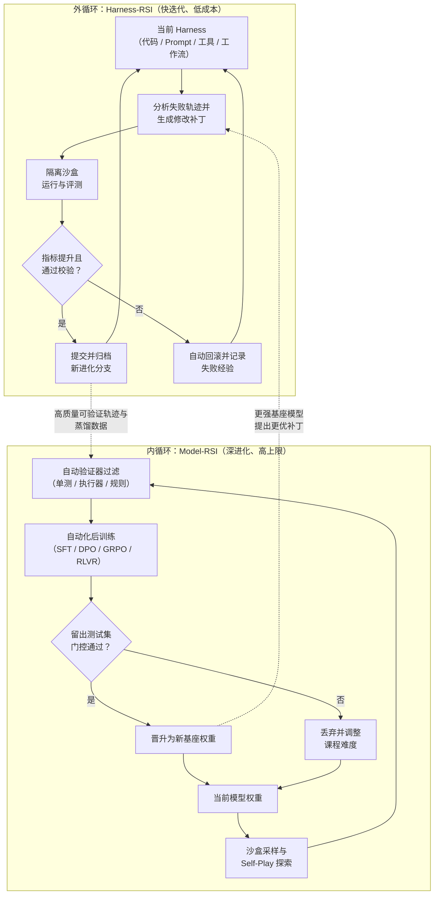

# OpenRSI

[](./LICENSE)
[](https://github.com/study8677/openrsi/stargazers)
[](https://github.com/study8677/openrsi/pulls)

[English](./README.md) | **中文**

> 一个开源的 **递归自我改进（Recursive Self-Improvement, RSI）** 引擎：让 AI Agent 在沙盒里自己改代码、自己验分、自动进化。

OpenRSI 致力于探索如何让 AI 系统以**可验证、可回滚、安全可控**的方式实现持续自我改进。我们不把“自我进化”混为一谈，而是将其清晰地拆分为两条互补的技术主线：

1. **[Harness-RSI（脚手架层自我进化）](./harness-rsi/README_zh.md)** — 冻结底层模型权重，递归进化模型*外围*的一切（Agent 代码、Prompt、工具链、Memory、工作流与搜索策略）。
2. **[Model-RSI（模型层自我进化）](./model-rsi/README_zh.md)** — 通过自生成轨迹、可验证奖励信号与自动化后训练闭环，递归进化模型*自身的参数权重*。

---

## 架构总览

两条主线共享同一个科学迭代内核：**提出改进 → 沙盒执行 → 验证打分 → 门控保留/回滚**，并在更高层次上构成双循环飞轮：



### 为什么需要双循环飞轮

- **Harness-RSI 反哺 Model-RSI**：更强的脚手架（更好的搜索、验证与工具调用）能解出更难的任务，产出高信噪比的可验证轨迹，直接用于蒸馏或微调模型权重。
- **Model-RSI 反哺 Harness-RSI**：更强的基座模型能更精准地定位脚手架的深层缺陷，用更少的试错轮次写出更高质量的代码与策略补丁。

---

## Harness-RSI 与 Model-RSI 对比

| 维度 | [Harness-RSI](./harness-rsi/README_zh.md) | [Model-RSI](./model-rsi/README_zh.md) |
| :--- | :--- | :--- |
| **进化对象** | Agent 源码、Prompt、工具、Memory、路由、规划与搜索逻辑 | 神经网络参数权重（LoRA / 全量权重） |
| **模型权重** | 冻结（兼容闭源 API 与开源模型） | 通过自动训练闭环更新（需要开源权重） |
| **单轮周期** | 分钟到小时级 | 小时到天级 |
| **成本与算力** | 低 —— 推理 API 成本 + 轻量沙盒 | 高 —— 需要 GPU 集群进行采样与 RL/SFT 训练 |
| **核心方法** | 代码自修改、Prompt 优化、工具合成、进化档案库（如 MAP-Elites） | 拒绝采样（STaR）、可验证强化学习（RLVR / GRPO）、DPO、自博弈课程 |
| **回滚与可审计性** | 极简 —— `git revert` 与人类可读的代码 Diff | 较重 —— Checkpoint 版本管理与全量回归评测 |
| **主要风险** | 过拟合测试集、钻评测空子（Reward Hacking）、补丁脆弱 | 模型坍塌（Model Collapse）、灾难性遗忘、奖励黑客 |
| **推荐切入点** | **优先落地** —— 反馈快、改动透明、立即可用 | **二期跟进** —— 在可验证任务与高质量轨迹就绪后接入 |

---

## 设计原则

1. **只信可验证的结果，不信自我感觉**：每一次自我修改都必须由确定性执行、单元测试或严格隔离的评测集裁决，绝不依赖无依据的模型自打分。
2. **评测不可变，目标可变**：Agent 可以改写目标脚手架或生成训练数据，但永远无权触碰评测代码与留出（Held-out）测试集。
3. **沙盒优先的安全边界**：所有候选代码变更与模型采样均在隔离沙盒中运行，具备严格的资源、网络与超时限制。
4. **基于谱系与档案库进化，而非盲目贪心**：保留多分支进化树，允许回溯与探索多样性，避免陷入局部最优。
5. **全流程可复现与开放**：每次进化运行都输出可检查的轨迹日志、Diff、得分记录与随机种子。

---

## 已验证实验结果（Harness-RSI MVP）

全链路基于本机 `codex exec`（ChatGPT OAuth 订阅，**零额外 API 费用**），OpenRSI 从最朴素的滑动窗口基线自动进化出高性能上下文压缩器：

1. **自研长任务上下文压缩基准（`14k–15k` tokens → `18%` 硬预算，隐藏 `pytest` 验分）**：
   - Baseline v0（滑动窗口）→ `train` 与未见 `held_out` 均为 **`0.000`**
   - RSI Gen 3（自动进化出的纯确定性证据抽取器）→ `train` 与未见 `held_out` 均达 **`1.000`（8/8 全通过，83.4% 压缩率）**
2. **CompactBench 官方全量 `practice`（Elite 难度 — 48/48 题、~32k tokens、8 大对抗家族混合、4 轮连续漂移、4,546 道探针）**：
   - **`OpenRSICompactor` v1（RSI 自动进化出的增量证据账本）**：**`0.762 [95% CI: 0.740, 0.784]`**（`3,535/4,546` 满分探针，抗漂移 **`0.815`**，第 0→4 轮衰减 `+0.164`（`0.90 → 0.69`），`0.0%` 中招率、`0.0%` 幻觉率、`0` 预算违规；`provenance_authority: 0.98`、`decision_override: 0.95`、`entity_confusion: 0.92`）—— 完整 48 题体检报告见 [`harness-rsi/reports/cb_leaderboard.md`](./harness-rsi/reports/cb_leaderboard.md)。

---

## 仓库结构

```text
openrsi/
├── README.md                              # 项目总览、架构与实验结果（英文）
├── README_zh.md                           # 项目总览（中文）
├── harness-rsi/
│   ├── README.md / README_zh.md           # Harness-RSI 架构说明与快速上手
│   ├── arena/
│   │   ├── fix-mini-kvstore/              # Harbor 沙盒任务（nop=0.0, oracle=1.0）
│   │   └── context-compaction/            # 长任务上下文压缩评测集（Train + Held-out）
│   ├── harness/
│   │   ├── compactor.py                   # 自动进化后的确定性压缩器（v1 评测集）
│   │   └── cb_compactor.py                # 自动进化后的增量证据账本（CompactBench）
│   ├── evolver/                           # `openrsi` CLI、Codex 适配器、评测器与进化引擎
│   └── reports/                           # 进化曲线、谱系归档与 CompactBench 对比榜单
└── model-rsi/
    ├── README.md / README_zh.md           # Model-RSI 架构说明与路线图
    └── requirements-colab.txt             # GPU 训练依赖（Phase 3 在 Colab 安装）
```

---

## 路线图（Roadmap）

- [x] **Phase 0 — 架构设计与规范**
  - 明确 `harness-rsi` 与 `model-rsi` 的双轨架构、核心接口与安全边界。
- [x] **Phase 1 — Harness-RSI 最小闭环（MVP）**
  - 完成 Harbor 沙盒任务（`fix-mini-kvstore`）、长任务上下文压缩基准、CompactBench 接入（本机 `codex exec`）、自动保留/回滚门控与进化曲线绘制。
- [ ] **Phase 2 — 多分支进化档案库与实时 Agent 中间件**
  - 引入 MAP-Elites 种群档案库、Pareto 多目标跟踪，并将进化后的压缩器接入 `codex app-server` 实时会话。
- [ ] **Phase 3 — Model-RSI 训练管线**
  - 搭建自动化轨迹采样、验证器过滤，以及面向开源权重的可插拔 SFT / GRPO / RLVR 训练配方。
- [ ] **Phase 4 — 双循环协同进化**
  - 打通飞轮：将 Harness-RSI 产出的突破性轨迹蒸馏进 Model-RSI，再把晋升后的新权重接回 Harness-RSI。

---

## 深入了解

- 阅读 **[Harness-RSI](./harness-rsi/README_zh.md)**：了解 Agent 如何在沙盒中自主改写代码、工具与工作流并完成验分。
- 阅读 **[Model-RSI](./model-rsi/README_zh.md)**：了解模型如何通过可验证采样与自动化后训练实现权重级自我进化。
