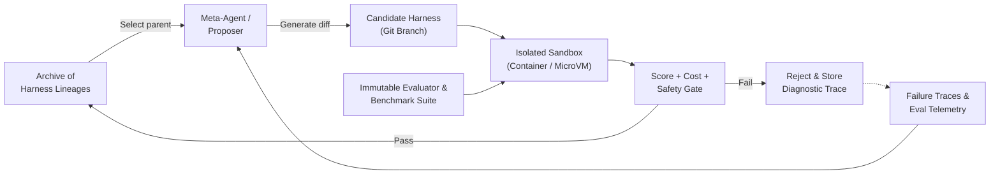

# Harness-RSI

**English** | [中文](./README_zh.md) | [← Back to OpenRSI](../README.md)

**Harness-RSI** improves an AI system's capability *without changing the underlying model weights*. Instead, the system treats its own **agent harness**—code, prompts, tools, memory, and control flow—as a mutable codebase that is continuously mutated, tested in isolated sandboxes, scored by immutable verifiers, and evolved over generations.

---

## Core Architecture



### Key Components

1. **Lineage Archive**: A Git-backed population of harness versions, recording each variant's parent, diff, benchmark scores, latency, and token cost.
2. **Meta-Agent (Proposer)**: Reads recent execution traces, error logs, and diff history, then proposes targeted code, prompt, or configuration patches.
3. **Isolated Sandbox**: Executes the candidate harness against tasks inside a clean, ephemeral environment with strict CPU/memory/timeout/network caps.
4. **Immutable Verifier**: Grades outputs using deterministic checks (unit tests, compilers, execution outcomes, or locked rubric suites) stored outside the agent's write permissions.
5. **Selection & Gating Engine**: Decides whether to promote, archive, or discard a candidate based on multi-objective criteria (accuracy, pass rate, cost, latency, and held-out generalization).

---

## The Evolvable Surface

Harness-RSI does not restrict self-modification to prompt tweaks. A harness can evolve across four layers:

| Layer | Examples of Evolvable Artifacts |
| :--- | :--- |
| **Control Flow & Orchestration** | Planning loops, reflection/critique steps, retry policies, multi-agent delegation, early stopping |
| **Context & Memory** | System prompts, few-shot selection, context compaction, episodic failure memory, retrieval heuristics |
| **Tools & Skills** | New helper scripts, static analysis wrappers, shell/editor ergonomics, structured output parsers |
| **Inference-Time Compute** | Best-of-N sampling, tree search, self-consistency voting, dynamic model routing (cheap vs. strong) |

---

## Guardrails & Anti-Reward-Hacking

Self-modifying code can easily cheat if the evaluation loop is sloppy. Harness-RSI enforces four hard boundaries:

- **Strict Permission Separation**: The candidate harness can only edit files inside its designated target directory; the evaluator, sandbox runner, and test suites are read-only or mounted separately.
- **Train / Val / Held-Out Split**: Mutations are guided by *train* traces, gated on *validation* benchmarks, and periodically audited on an unseen *held-out* set to detect overfitting.
- **Cost & Complexity Regularization**: A patch that gains +0.5% accuracy while multiplying token cost by 5× or adding fragile bloat is penalized unless explicitly targeting a high-compute tier.
- **Instant Rollback**: Every generation is a Git commit/branch—any regression or instability can be reverted cleanly with full diff auditability.

---

## Selection Strategies

- **Greedy Hill-Climbing (MVP)**: Always mutate from the highest-scoring parent; keep only strict improvements. Simple, fast, good for early validation.
- **Population / Archive Search (e.g., MAP-Elites / Stepping-Stone Archive)**: Maintain diverse parents across niches (e.g., low-cost vs. high-accuracy, different architectures) so evolution can cross valleys and combine ideas across branches.

---

## Quickstart

```bash
cd harness-rsi
uv sync

# 1. Verify Harbor sandbox demo task (nop=0.0, oracle=1.0)
uv run harbor run -p arena/fix-mini-kvstore -a nop
uv run harbor run -p arena/fix-mini-kvstore -a oracle

# 2. Evaluate & evolve on OpenRSI context-compaction arena (18% token budget)
uv run openrsi generate-arena
uv run openrsi eval --split all
uv run openrsi evolve --generations 3

# 3. Evaluate, diagnose traces & evolve on CompactBench (32k tokens Elite multi-cycle drift)
uv run openrsi cb-eval --suite practice --seed-group default --budget-tokens 2048 --concurrency 2 --output reports/run.jsonl --resume --traces reports/run.traces.jsonl
uv run openrsi cb-analyze reports/run.jsonl --traces reports/run.traces.jsonl --save-json reports/run.diagnostics.json
uv run openrsi cb-evolve --suite practice --seed-group openrsi_dev --cases-per-family 6 --generations 2 --baseline-xray reports/run.summary.json --diagnostics reports/run.diagnostics.json

# 4. Use the evolved Delta Evidence Ledger as live session middleware
# from harness.middleware import SessionCompactionMiddleware
uv run pytest tests/test_middleware.py -v
```

---

## Roadmap

- [x] **H1 — Minimal Self-Editing Loop**: CLI runner (`openrsi`) with sandbox/deterministic verifier and automatic keep/rollback gating.
- [x] **H2 — Trace-Driven Diagnostics & CompactBench Elite Mastery**: Built `openrsi cb-analyze` structural trace diagnostics (birth-loss vs drift-eviction vs confusion), pushed full 48-case Elite `practice` (4,546 probes) from `0.762 → 0.806 [0.784, 0.829]` with `0` budget violations, and beat `built-in:codex-cli` by **+17.1 pts** (`0.577` vs `0.406`) at `1,024`-token extreme compression (~50×).
- [x] **H3 — Plug-and-Play Session Compaction Middleware**: Packaged `SessionCompactionMiddleware` (`harness/middleware.py`) for live long-horizon agent workflows.
- [ ] **H4 — Trajectory Export for Model-RSI**: Automatically export verified successful runs into a standard dataset format consumable by [`model-rsi`](../model-rsi/README.md).
