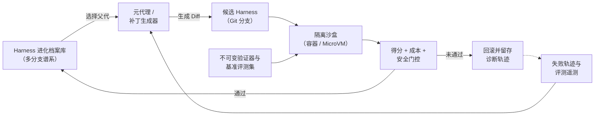

# Harness-RSI（脚手架层自我进化）

[English](./README.md) | **中文** | [← 返回 OpenRSI 首页](../README_zh.md)

**Harness-RSI** 在**不改动底层模型权重**的前提下提升 AI 系统的整体能力。它将 Agent 自身的外围脚手架（代码、Prompt、工具链、Memory 与控制流）视为可演化的代码库，通过“提出补丁 → 隔离沙盒运行 → 不可变验证器打分 → 保留或回滚”的闭环实现多代自动进化。

---

## 核心架构



### 核心模块

1. **进化档案库（Lineage Archive）**：基于 Git 管理的 Harness 版本谱系，记录每一代的父节点、代码 Diff、评测得分、耗时与 Token 成本。
2. **元代理（Meta-Agent / Proposer）**：阅读近期的执行轨迹、错误日志与历史改动，提出有针对性的代码、Prompt 或配置补丁。
3. **隔离沙盒（Isolated Sandbox）**：在干净、一次性的受限环境中运行候选 Harness，严格限制 CPU、内存、超时与网络访问。
4. **不可变验证器（Immutable Verifier）**：通过确定性检查（单元测试、编译器、执行结果或锁定的评测规则）打分，评测代码位于 Agent 写权限之外。
5. **筛选与门控引擎（Selection & Gating）**：综合准确率、通过率、成本、延迟以及留出集泛化表现，决定晋升、归档还是回滚。

---

## 可进化面（The Evolvable Surface）

Harness-RSI 不仅限于微调 Prompt，而是覆盖四个层次：

| 层次 | 可进化的具体对象 |
| :--- | :--- |
| **控制流与编排** | 规划循环、反思/自检步骤、重试策略、多 Agent 分工、早停条件 |
| **上下文与记忆** | System Prompt、Few-shot 选择、上下文压缩、历史失败记忆、检索启发式 |
| **工具与技能** | 自动生成的辅助脚本、静态检查封装、编辑/终端工具接口、结构化输出解析 |
| **推理时计算（Test-Time Compute）** | Best-of-N 采样、树搜索、自洽投票、动态模型路由（便宜模型 vs 强模型） |

---

## 安全边界与防作弊机制

如果评测闭环设计不严谨，自修改代码很容易“钻空子”。Harness-RSI 强制执行四条硬边界：

- **严格权限隔离**：候选 Harness 仅能修改目标目录内的代码；验证器、沙盒调度器与测试集保持只读或独立挂载。
- **训练 / 验证 / 留出集切分**：用 *Train* 轨迹指导修改，用 *Validation* 决定是否保留，并定期在不可见的 *Held-out* 测试集上审计，防止过拟合评测集。
- **成本与复杂度约束**：如果一个补丁只换来 +0.5% 的分数，却让 Token 消耗翻 5 倍或引入脆弱的堆砌逻辑，门控机制会予以惩罚。
- **一键可回滚**：每一代都是独立的 Git 提交/分支，任何退化或异常都可以精准回退并完整审计 Diff。

---

## 进化筛选策略

- **贪心爬山（MVP 阶段）**：始终基于当前最高分版本继续变异，只保留严格提升的改动。实现简单、收敛快，适合早期验证。
- **种群 / 档案库搜索（如 MAP-Elites）**：在不同生态位（如低成本档、高精度档、不同架构流派）同时保留多个父代，避免陷入局部最优，并支持跨分支吸收优秀改动。

---

## 快速上手

```bash
cd harness-rsi
uv sync

# 1. 验收 Harbor 沙盒 Demo 任务（nop=0.0, oracle=1.0）
uv run harbor run -p arena/fix-mini-kvstore -a nop
uv run harbor run -p arena/fix-mini-kvstore -a oracle

# 2. 在自研长任务上下文压缩基准上评测与进化（18% Token 硬预算）
uv run openrsi generate-arena
uv run openrsi eval --split all
uv run openrsi evolve --generations 3

# 3. 在 CompactBench 多轮漂移难题集上评测与进化（支持 32k tokens Elite 难度）
uv run openrsi cb-eval --suite practice --seed-group practice_eval --cases-per-family 2
uv run openrsi cb-eval --method built-in:codex-cli --suite practice --seed-group practice_eval --cases-per-family 2
uv run openrsi cb-evolve --suite practice --cases-per-family 1 --generations 2
```

---

## 路线图（Roadmap）

- [x] **H1 — 最小自修改闭环**：`openrsi` 命令行驱动器，完成沙盒/确定性验分与自动保留/回滚门控。
- [x] **H2 — 轨迹归因与 CompactBench 接入**：按家族与轮次输出漂移诊断，在 Elite `practice` 上反超 `built-in:codex-cli`（`0.707` vs `0.697`，抗漂移 `0.783` vs `0.557`）。
- [ ] **H3 — 进化档案库与实时中间件**：MAP-Elites 多分支进化树，并将进化后的压缩器挂入 `codex app-server` 实时长会话。
- [ ] **H4 — 向 Model-RSI 导出高质量轨迹**：将验证通过的优质运行轨迹自动导出为标准数据集，供 [`model-rsi`](../model-rsi/README_zh.md) 使用。
