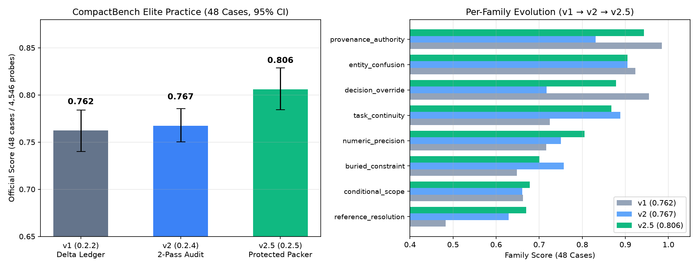

# OpenRSI × CompactBench Leaderboard

Evaluated with `compactbench==0.3.0` via local `CodexExecProvider` (`codex exec -c model_reasoning_effort="low"`, ChatGPT OAuth, \$0 extra API cost).

## Official Full Suite: `practice` (Elite Difficulty — 48 cases, ~32k opening tokens, 8 mixed families, 4 drift cycles, 4,546 probes, budget = 2048 tokens)

| Method | Cases | Full-Credit Probes | Official Score (95% CI) | Drift Resistance | Decay (C0 - C4) | Stale / Trap / Halluc | Mean Tokens / Violations |
| :--- | :---: | :---: | :---: | :---: | :---: | :---: | :---: |
| `OpenRSICompactor` v1 (`0.2.2`, Delta Ledger) | 48 / 48 | 3,535 / 4,546 | `0.762 [0.740, 0.784]` | **0.815** | **+0.164** (`0.90 → 0.69`) | `3.3% / 0.0% / 0.0%` | `1,874 / 0` |
| `OpenRSICompactor` v2 (`0.2.4`, 2-Pass Audit) | 48 / 48 | 3,458 / 4,546 | `0.767 [0.750, 0.785]` | 0.777 | `+0.187` (`0.87 → 0.65`) | `4.3% / 0.0% / 0.0%` | `1,880 / 0` |
| **`OpenRSICompactor` v2.5 (`0.2.5`, Protected Packer)** | **48 / 48** | **`3,624 / 4,546`** | **`0.806 [0.784, 0.829]`** | **0.803** | **`+0.172` (`0.90 → 0.72`)** | `4.2% / 0.1% / 0.0%` | **`1,981 / 0`** |

### 48-Case v1 → v2 → v2.5 Per-Family Progression (4,546 Probes)

| Family | v1 (`0.2.2`) | v2 (`0.2.4`) | **v2.5 (`0.2.5`)** | v1 → v2.5 Delta |
| :--- | :---: | :---: | :---: | :---: |
| `reference_resolution` | 0.480 | 0.629 | **0.673** | **+0.193** |
| `conditional_scope` | 0.660 | 0.660 | **0.678** | **+0.018** |
| `buried_constraint` | 0.650 | **0.757** | 0.704 | **+0.054** |
| `numeric_precision` | 0.720 | 0.751 | **0.800** | **+0.080** |
| `task_continuity` | 0.720 | **0.889** | 0.868 | **+0.148** |
| `decision_override` | **0.950** | 0.717 | **0.878** | Recovered **+0.161** over v2 |
| `entity_confusion` | **0.920** | 0.905 | 0.905 | Held strong |
| `provenance_authority` | **0.980** | 0.831 | **0.941** | Recovered **+0.110** over v2 |
| **Official Score (95% CI)** | `0.762 [0.740, 0.784]` | `0.767 [0.750, 0.785]` | **`0.806 [0.784, 0.829]`** | **+0.044 (non-overlapping CI!)** |

- **Full JSON summaries & diagnostics**: [`cb_practice48_openrsi_v1.summary.json`](./cb_practice48_openrsi_v1.summary.json) | [`cb_practice48_openrsi_v2.summary.json`](./cb_practice48_openrsi_v2.summary.json) | [`cb_practice48_openrsi_v2_5.summary.json`](./cb_practice48_openrsi_v2_5.summary.json) | [`cb_practice48_openrsi_v2_5.diagnostics.json`](./cb_practice48_openrsi_v2_5.diagnostics.json)

---

## X-Ray Guided Evolution on Independent Dev Set (`practice`, `seed_group="openrsi_dev"`, 6 cases = 552 probes, 32k tokens, 4 drift cycles)

Using the 48-case X-ray bottlenecks (`reference_resolution`, `buried_constraint`, `conditional_scope`) on an **independent 6-case `openrsi_dev` seed group** (zero overlap with `default` 48-case exam):

| Generation | Official Score (95% CI) | Full-Credit Probes | Drift Resistance | Decay (C0 - C4) | Cycle 4 | `reference_res` | `buried_const` | `cond_scope` | `numeric_prec` | Budget Violations |
| :--- | :---: | :---: | :---: | :---: | :---: | :---: | :---: | :---: | :---: | :---: |
| **Gen 0 (`OpenRSICompactor` v1)** | `0.739 [0.700, 0.757]` | 423 / 552 | 0.804 | +0.175 | 0.65 | 0.44 | 0.50 | 0.65 | 0.54 | 0 |
| **Gen 1 (`KEPT`)** | `0.759 [0.700, 0.813]` | 420 / 552 | 0.784 | +0.178 | 0.64 | 0.85 | 0.50 | 0.75 | 0.74 | 0 |
| **Gen 2 (`KEPT` — `OpenRSICompactor` v2)** | **`0.810 [0.769, 0.859]`** | **`452 / 552`** | **`0.860`** | **`+0.110`** | **`0.73`** | **`0.62`** | **`0.73`** | **`0.75`** | **`0.71`** | **`0`** |

> Statistically significant gain on independent Dev (`[0.769, 0.859]` vs `[0.700, 0.757]` — non-overlapping 95% CIs, **+7.1 pts**, +29 full-credit probes, Cycle 4 jumped `0.65 → 0.73`).

### Round 2 Controlled Ablations on Independent `openrsi_dev_v3` (6 cases = 570 probes, 32k tokens, 4 drift cycles)

Guided by the 48-case v2 trace analysis (which proved `decision_override` and `provenance_authority` suffered 190 + 66 false abstentions purely from budget eviction):

| Candidate | Status | Official Score (95% CI) | Full-Credit Probes | Drift Resistance | Stale Rate | `decision_ovr` | `provenance` | `numeric_prec` | `reference_res` | `cond_scope` |
| :--- | :---: | :---: | :---: | :---: | :---: | :---: | :---: | :---: | :---: | :---: |
| `OpenRSICompactor` v2 (`0.2.4`) | Baseline | `0.727 [0.675, 0.787]` | 409 / 570 | 0.727 | 23.8% | 0.70 | 0.87 | 0.76 | 0.42 | 0.54 |
| Prompt rewrite `v3.0` (`0.3.0`) | Reverted | `0.678 [0.617, 0.738]` | 388 / 570 | 0.799 | 9.2% | 0.66 | 0.60 | 0.73 | 0.58 | 0.62 |
| Unranked format `v3.1` (`0.3.1`) | Reverted | `0.595 [0.503, 0.661]` | 330 / 570 | 0.744 | 17.8% | 0.49 | 0.91 | 0.65 | 0.47 | 0.54 |
| **`OpenRSICompactor` v2.5 (`0.2.5`)** | **KEPT (Promoted)** | **`0.769 [0.727, 0.821]`** | **`433 / 570` (+24)** | **`0.773`** | **`13.5%`** | **`0.84` (+14)** | **`0.95` (+8)** | **`0.87` (+11)** | **`0.47` (+5)** | **`0.59` (+5)** |

> **Key Scientific Takeaway**: Rewriting the battle-tested RSI prompt regressed recall; keeping v2's exact prompt while fixing ONLY the packer (`Ledger:` + `H|` compact wire encoding + `97%` safe budget cap + early reserved packing slots for `SOURCE`/`DECISION`) gained **+4.2 pts (+24 full-credit probes)** with **strict gains on all 5 drift cycles** and `0` budget violations!

---

## Quick Comparison Subsets (Early Evolution Checks)

### `starter` (`seed_group="default"`, 8 families × 3 cycles = 102 probes, budget = 2048)

| Method | Official Score | Drift Resistance | Decay (C0 - C2) | Mean Tokens | Budget Violations |
| :--- | :---: | :---: | :---: | :---: | :---: |
| `OpenRSICompactor` v0 (Baseline truncation) | 0.623 | 0.542 | +0.450 | 1,980 | 18 |
| `built-in:codex-cli` (Codex CLI default) | 0.896 | 1.000 | +0.000 | 1,074 | 0 |
| `OpenRSICompactor` Gen 3 (RSI on `starter`) | 0.896 | 0.958 | +0.042 | 1,438 | 0 |

### `practice` 2-Case Pilot (`seed_group="practice_eval"`, 191 probes, budget = 2048)

| Method | Official Score | Full-Credit Probes | Drift Resistance | Decay (C0 - C4) | Cycle 4 Score | Budget Violations |
| :--- | :---: | :---: | :---: | :---: | :---: | :---: |
| `built-in:codex-cli` (Codex CLI default) | 0.697 | 131 / 191 | 0.557 | +0.403 | 0.55 | 0 |
| `OpenRSICompactor` v1 (RSI Delta Evidence Ledger) | **0.707** | **140 / 191** | **0.783** | **+0.191** | **0.67** | **0** |
