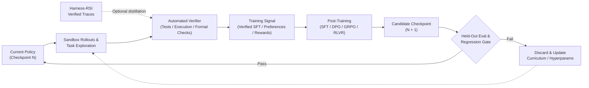

# Model-RSI

**English** | [中文](./README_zh.md) | [← Back to OpenRSI](../README.md)

**Model-RSI** improves the AI model's *internal weights* across successive generations. Instead of relying solely on human-labeled datasets, the model generates its own solutions and tasks, filters or scores them through automated verifiers in sandboxes, trains on the resulting signal, and promotes a stronger checkpoint only after passing strict held-out gates.

---

## Core Architecture

### Key Components

1. **Rollout & Self-Play Engine**: Samples diverse trajectories from the current checkpoint (optionally amplified by a strong harness or test-time search).
2. **Automated Verifier**: Produces objective, ground-truth rewards—such as unit test pass/fail, compilation success, mathematical equivalence, or sandbox execution checks.
3. **Data & Curriculum Manager**: Balances difficulty (targeting the frontier where pass rate is neither 0% nor 100%), deduplicates trajectories, and mixes anchor data to prevent forgetting.
4. **Post-Training Runner**: Pluggable training backend supporting LoRA or full-parameter updates via SFT, DPO, or online RL (GRPO / PPO / RLVR).
5. **Promotion Gate**: Evaluates candidate checkpoints on unseen held-out benchmarks plus general capability anchors before promoting Checkpoint `N + 1`.

---

## Core Evolution Paradigms

| Paradigm | How It Works | Trade-offs |
| :--- | :--- | :--- |
| **Rejection Sampling / STaR (Verified SFT)** | Sample many solutions per problem, keep only verifier-approved traces, fine-tune on them | Simple, stable, works well with small compute; weaker on learning from negative examples |
| **RLVR (GRPO / PPO)** | Optimize policy directly against verifiable sandbox rewards over grouped rollouts | Strongest ceiling on reasoning & coding; requires careful reward design and RL stability |
| **Preference Optimization (DPO / Iterative DPO)** | Pair verified winning traces against failing traces from the same prompt | Uses negative signal cleanly without full online RL complexity |
| **Harness-to-Model Distillation** | Run expensive `harness-rsi` search/tooling to solve hard tasks, then distill the final verified solution into model weights | Turns slow inference-time compute into fast single-pass model intuition |
| **Self-Play & Frontier Curriculum** | Co-evolve a task generator and solver so training tasks stay just above the model's current skill level | Prevents dataset saturation; hardest to keep grounded and non-degenerate |

---

## Key Risks & Guardrails

Recursive training on model-generated data introduces distinct failure modes that must be guarded against:

- **Model Collapse & Diversity Loss**: Training purely on self-generated text can narrow the distribution. Mitigate with strict external verifiers, temperature/search diversity, and mixing verified anchor datasets.
- **Reward Hacking**: Models may exploit weak verifiers (e.g., trivializing tests or gaming heuristics). Keep verifiers deterministic, sandboxed, and audited against held-out checks.
- **Catastrophic Forgetting**: Narrow domain self-improvement can degrade general skills. Always include a general regression suite in the promotion gate.
- **Benchmark Contamination**: Strictly separate rollout task pools from held-out evaluation benchmarks.

---

## Roadmap

- [ ] **M1 — Unified Trajectory & Verifier Schema**: Standardize how verified rollouts (from direct model sampling or `harness-rsi`) are stored, scored, and filtered.
- [ ] **M2 — Verified SFT / Rejection Sampling Loop**: End-to-end iterative STaR pipeline on open-weight models with automated held-out gating.
- [ ] **M3 — RLVR (GRPO) Integration**: Pluggable sandboxed RL training loop for coding and verifiable reasoning tasks.
- [ ] **M4 — Frontier Curriculum & Dual-Loop Flywheel**: Automatic difficulty scheduling and closed-loop distillation between [`harness-rsi`](../harness-rsi/README.md) and `model-rsi`.
