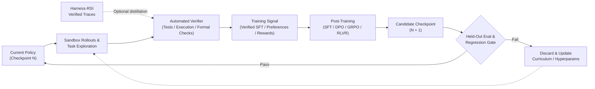
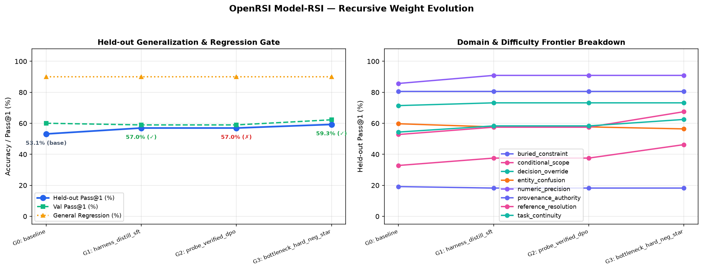
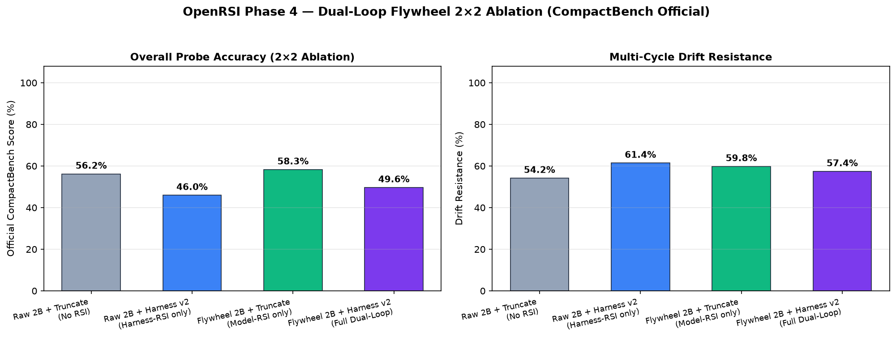
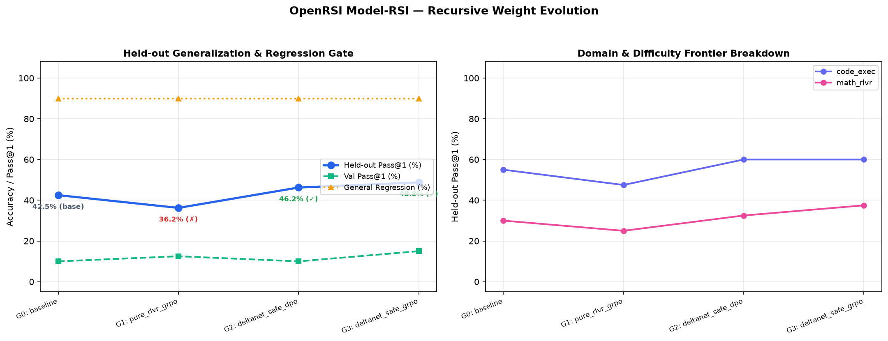
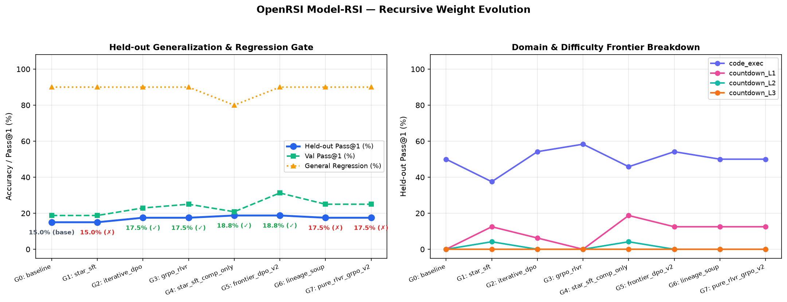

# Model-RSI

**English** | [中文](./README_zh.md) | [Technical Report (ZH)](./docs/TECHNICAL_REPORT_zh.md) | [← Back to OpenRSI](../README.md)

**Model-RSI** improves the AI model's *internal weights* across successive generations. Instead of relying solely on human-labeled datasets, the model generates its own solutions and tasks, filters or scores them through automated verifiers in sandboxes, trains on the resulting signal, and promotes a stronger checkpoint only after passing strict held-out gates.

---

## Core Architecture



### Key Components

1. **Rollout & Self-Play Engine**: Samples diverse trajectories from the current checkpoint (optionally amplified by a strong harness or test-time search).
2. **Automated Verifier**: Produces objective, ground-truth rewards—such as unit test pass/fail, compilation success, mathematical equivalence, or sandbox execution checks.
3. **Data & Curriculum Manager**: Balances difficulty (targeting the frontier where pass rate is neither 0% nor 100%), deduplicates trajectories, and mixes anchor data to prevent forgetting.
4. **Post-Training Runner**: Pluggable training backend supporting LoRA or full-parameter updates via SFT, DPO, or online RL (GRPO / PPO / RLVR).
5. **Promotion Gate**: Evaluates candidate checkpoints on unseen held-out benchmarks plus general capability anchors before promoting Checkpoint `N + 1`.

---

## Core Evolution Paradigms

| Paradigm | How It Works | Trade-offs |
| :--- | :--- | :--- |
| **Rejection Sampling / STaR (Verified SFT)** | Sample many solutions per problem, keep only verifier-approved traces, fine-tune on them | Simple, stable, works well with small compute; weaker on learning from negative examples |
| **RLVR (GRPO / PPO)** | Optimize policy directly against verifiable sandbox rewards over grouped rollouts | Strongest ceiling on reasoning & coding; requires careful reward design and RL stability |
| **Preference Optimization (DPO / Iterative DPO)** | Pair verified winning traces against failing traces from the same prompt | Uses negative signal cleanly without full online RL complexity |
| **Harness-to-Model Distillation** | Run expensive `harness-rsi` search/tooling to solve hard tasks, then distill the final verified solution into model weights | Turns slow inference-time compute into fast single-pass model intuition |
| **Self-Play & Frontier Curriculum** | Co-evolve a task generator and solver so training tasks stay just above the model's current skill level | Prevents dataset saturation; hardest to keep grounded and non-degenerate |

---

## Key Risks & Guardrails

Recursive training on model-generated data introduces distinct failure modes that must be guarded against:

- **Model Collapse & Diversity Loss**: Training purely on self-generated text can narrow the distribution. Mitigate with strict external verifiers, temperature/search diversity, and mixing verified anchor datasets.
- **Reward Hacking**: Models may exploit weak verifiers (e.g., trivializing tests or gaming heuristics). Keep verifiers deterministic, sandboxed, and audited against held-out checks.
- **Catastrophic Forgetting**: Narrow domain self-improvement can degrade general skills. Always include a general regression suite in the promotion gate.
- **Benchmark Contamination**: Strictly separate rollout task pools from held-out evaluation benchmarks.

---

## Experimental Results (Colab NVIDIA GPU)

### Run 3 (Phase 4 Dual-Loop Flywheel Closure): `Harness-RSI ↔ Model-RSI` on Official `CompactBench`

Closed the full Phase 4 Dual-Loop Flywheel using `harness-rsi`'s 48 Elite cases (4,659 official deterministic probes, strictly split 36/6/6 by `case_id`) to distill and hard-negative-refine `Qwen/Qwen3.5-2B` (DeltaNet-Safe), then plugged the evolved `OpenRSI-Qwen3.5-2B-Flywheel` back into official `compactbench==0.3.0` via [HFCompactBenchProvider](./model_rsi/flywheel_provider.py) for a live 2×2 ablation with `OpenRSICompactor v2`:




- **Phase 4A (`Harness → Model`, 249 unseen 32k Elite probes)**: `53.15% (Gen 0) → 56.97% (Gen 1 Distill) → 59.28% (Gen 3 Hard-Neg STaR)` (**`+6.13%`**, full-credit `127/249 → 141/249`, JSON `100%`, regression locked at `90.00%`; P0 `reference_resolution` **`52.78% → 67.50%` (+14.72%)**, P1 `conditional_scope` **`32.81% → 46.25%` (+13.44%)**).
- **Phase 4B (`Model → Harness`, official `starter` 102-probe 2×2 ablation)**: `OpenRSI-Qwen3.5-2B-Flywheel` improves over raw `Qwen3.5-2B` under both `truncate-last-n` (`56.20% → 58.26%`, **`+2.06%`**, drift resistance `+5.64%`) and `OpenRSICompactor v2` (`45.95% → 49.65%`, **`+3.70%`**, stale-memory rate cut **`-13.33%`** from `53.33% → 40.00%`). Full analysis in [`reports/phase4_flywheel_report.md`](./reports/phase4_flywheel_report.md).

### Run 2 (Flagship): `Qwen/Qwen3.5-2B` on Official Open-Source RLVR Benchmarks (`MATH-500` + `HumanEval+`)

Trained on `open-r1/Big-Math-RL-Verified-Processed` (L1–L2) + `KodCode/KodCode-V1` + `MBPP`, gated on locked external **`HuggingFaceH4/MATH-500`** (40 tasks) + **`evalplus/humanevalplus`** (40 tasks) + 10 general regression checks:



| Gen | Paradigm | Gate Status | Held-out Pass@1 | MATH-500 (HO) | HumanEval+ (HO) | Hard Val | Regression |
| ---: | :--- | :--- | ---: | ---: | ---: | ---: | ---: |
| 0 | `baseline` (`Qwen/Qwen3.5-2B`) | baseline | 42.50% | 30.00% | 55.00% | 10.00% | 90.00% |
| 1 | `pure_rlvr_grpo` (`all-linear`) | rejected | 36.25% | 25.00% | 47.50% | 12.50% | 90.00% |
| 2 | `deltanet_safe_dpo` (freeze `in_proj_a/b`) | **promoted** | 46.25% | 32.50% | **60.00%** | 10.00% | 90.00% |
| 3 | `deltanet_safe_grpo` (strict frontier) | **promoted** | **48.75%** | **37.50%** | **60.00%** | **15.00%** | **90.00%** |

Key finding: freezing Qwen3.5's sensitive Gated DeltaNet recurrence gates (`in_proj_a`/`in_proj_b`) and running DeltaNet-safe Iterative DPO → Strict-Frontier Pure-Binary RLVR GRPO boosted official Held-out Pass@1 by **`+6.25%`** (`42.50% → 48.75%`, with `MATH-500` `+7.50%` and `HumanEval+` `+5.00%`) at **`90.00%` regression (zero forgetting)**. See [`reports/qwen35_2b_experiment_summary.md`](./reports/qwen35_2b_experiment_summary.md).

### Run 1: `Qwen/Qwen2.5-1.5B-Instruct` (8-Gen Countdown + MBPP)

We ran an end-to-end 8-generation (`Gen 0 → Gen 7`) Model-RSI loop on Google Colab L4 GPU across strictly disjoint splits of **Countdown Arithmetic Reasoning** (deterministic AST + exact `Fraction` verifier), **MBPP Sanitized Python Coding** (isolated `python -I` subprocess sandbox), and a **10-item General Regression Gate**:



| Gen | Paradigm | Gate Status | Held-out Pass@1 | Val Pass@1 | MBPP Code (HO) | Countdown L1 (HO) | Regression |
| ---: | :--- | :--- | ---: | ---: | ---: | ---: | ---: |
| 0 | `baseline` | baseline | 15.00% | 18.75% | 50.00% | 0.00% | 90.00% |
| 1 | `star_sft` (full-seq) | rejected | 15.00% | 18.75% | 37.50% | 12.50% | 90.00% |
| 2 | `iterative_dpo` | **promoted** | 17.50% | 22.92% | 54.17% | 6.25% | 90.00% |
| 3 | `grpo_rlvr` | **promoted** | 17.50% | 25.00% | **58.33%** | 0.00% | 90.00% |
| 4 | `star_sft_comp_only` | **promoted** | **18.75%** | 20.83% | 45.83% | **18.75%** | 80.00% |
| 5 | `frontier_dpo_v2` | **promoted** | **18.75%** | **31.25%** | 54.17% | 12.50% | **90.00%** |
| 6 | `lineage_soup` | rejected | 17.50% | 25.00% | 50.00% | 12.50% | 90.00% |
| 7 | `pure_rlvr_grpo_v2` | rejected | 17.50% | 25.00% | 50.00% | 12.50% | 90.00% |

Full diagnostics (including the Gen 3 length-collapse reward-hacking diagnosis and pure-binary RLVR cure) are archived in [`reports/experiment_summary.md`](./reports/experiment_summary.md) and [`reports/evolution_history.json`](./reports/evolution_history.json).

---

## Quickstart

```bash
cd model-rsi
uv run pytest -v                        # Run deterministic verifier, curriculum, gating & flywheel tests
uv run model-rsi status                 # Inspect multi-generation evolution ledger
uv run model-rsi plot                   # Render reports/evolution_curve.png
uv run model-rsi generate-tasks         # Export disjoint train/val/held_out/regression JSONL splits
uv run model-rsi import-harness         # Import verified Harness-RSI traces (M4 flywheel)
```

For full GPU post-training (STaR SFT, Iterative DPO, Online GRPO/RLVR, and Lineage Model Soup) on Google Colab (L4 / A100 / H100), install `requirements-colab.txt` and run `colab/run_model_rsi_colab.py`.

---

## Roadmap

- [x] **M1 — Unified Trajectory & Verifier Schema**: Standardize how verified rollouts (from direct model sampling or `harness-rsi`) are stored, scored, and filtered (`model_rsi/protocol.py`, `model_rsi/tasks/`).
- [x] **M2 — Verified SFT / Rejection Sampling Loop**: End-to-end iterative STaR (completion-only LoRA SFT) & Iterative DPO pipelines with automated held-out & regression gating (`model_rsi/trainers/star_sft.py`, `iterative_dpo.py`, `gating.py`).
- [x] **M3 — RLVR (GRPO) Integration**: Pluggable sandboxed online GRPO training loop with anti-reward-hacking pure-binary verifiable rewards (`model_rsi/trainers/grpo_rlvr.py`).
- [x] **M4 — Frontier Curriculum & Dual-Loop Flywheel**: Frontier mastery scheduler (`model_rsi/curriculum.py`), lineage weight-space merging (`model_rsi/trainers/lineage_merge.py`), and closed-loop distillation from [`harness-rsi`](../harness-rsi/README.md) (`model_rsi/flywheel.py`).
