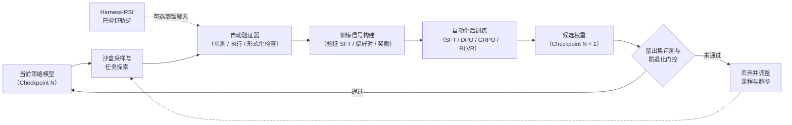

# Model-RSI（模型层自我进化）

[English](./README.md) | **中文** | [← 返回 OpenRSI 首页](../README_zh.md)

**Model-RSI** 通过多代自动化闭环持续提升 AI 模型*自身的参数权重*。它不再单纯依赖人工标注数据，而是让模型自主采样解题或生成任务，通过沙盒中的自动验证器筛选出客观高质量信号，执行自动化后训练，并在严格通过留出测试集门控后晋升为新一代基座权重。

---

## 核心架构

### 核心模块

1. **采样与自博弈引擎（Rollout & Self-Play）**：基于当前 Checkpoint 生成多样化解题轨迹（也可叠加更强的 Harness 或推理时搜索来放大探索能力）。
2. **自动验证器（Automated Verifier）**：给出客观可验证的真实奖励，例如单元测试通过、代码编译执行成功、数学等价性校验等。
3. **数据与课程管理器（Data & Curriculum）**：动态控制任务难度（聚焦模型当前通过率既不是 0% 也不是 100% 的能力边界），去重并混入锚点数据防止遗忘。
4. **后训练执行器（Post-Training Runner）**：可插拔的训练后端，支持 LoRA 或全量参数的 SFT、DPO 以及在线强化学习（GRPO / PPO / RLVR）。
5. **晋升门控（Promotion Gate）**：在不可见的留出评测集与通用能力回归集上全面验分，只有真正变强才晋升为 `Checkpoint N + 1`。

---

## 核心进化范式

| 范式 | 工作方式 | 特点与权衡 |
| :--- | :--- | :--- |
| **拒绝采样 / STaR（验证 SFT）** | 对同一题采样多条轨迹，只保留验证通过的样本进行微调 | 实现简单、训练稳定、算力友好；对负样本利用不足 |
| **可验证强化学习（RLVR / GRPO / PPO）** | 直接依据沙盒验证奖励对分组采样轨迹进行策略优化 | 推理与编程能力上限最高；对奖励设计与训练稳定性要求高 |
| **迭代偏好优化（Iterative DPO）** | 将同一题下验证通过与失败的轨迹配成偏好对训练 | 能充分利用负样本信号，复杂度低于在线 RL |
| **Harness-to-Model 蒸馏** | 先用高算力的 `harness-rsi` 搜索与工具链攻克难题，再把验证通过的解蒸馏进模型权重 | 将昂贵的推理时搜索转化为模型自身的单步直觉 |
| **自博弈与前沿课程（Self-Play）** | 协同进化“出题器”与“解题器”，让训练任务始终紧贴模型当前能力边界 | 解决静态数据集见顶问题；但最难防止题目退化或失真 |

---

## 核心风险与护栏

用模型自生成数据进行多代递归训练，必须防范以下典型风险：

- **模型坍塌与多样性退化（Model Collapse）**：长期只在自产数据上训练会导致分布变窄。需要结合严格外部验证器、高多样性采样以及高质量锚点数据混合来缓解。
- **奖励黑客（Reward Hacking）**：模型可能学会钻验证器空子（如敷衍测试或迎合启发式规则）。验证器必须保持确定性、沙盒隔离，并接受留出集审计。
- **灾难性遗忘（Catastrophic Forgetting）**：窄领域自我强化可能损伤通用能力。晋升门控必须包含通用能力回归测试。
- **评测集污染（Contamination）**：采样任务池必须与留出评测集严格隔离。

---

## 路线图（Roadmap）

- [ ] **M1 — 统一轨迹与验证器协议**：标准化可验证轨迹（来自模型直采或 `harness-rsi`）的存储、打分与过滤格式。
- [ ] **M2 — 验证 SFT / 拒绝采样闭环**：在开源模型上跑通端到端迭代 STaR 管线与自动留出集门控。
- [ ] **M3 — 接入 RLVR（GRPO）**：提供面向代码与可验证推理任务的可插拔沙盒强化学习训练流。
- [ ] **M4 — 前沿课程与双循环飞轮**：实现难度自动调度，并与 [`harness-rsi`](../harness-rsi/README_zh.md) 打通闭环蒸馏。
