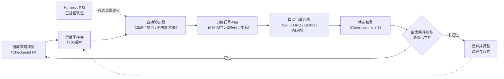
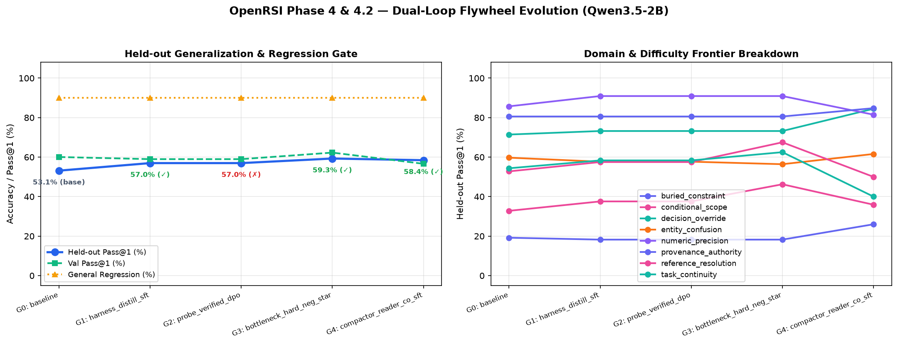
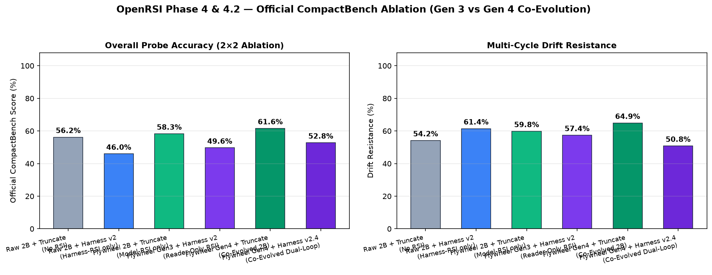
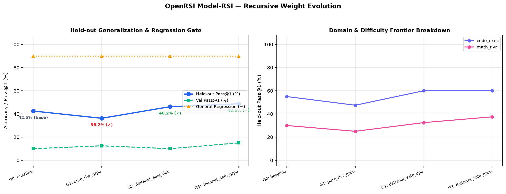
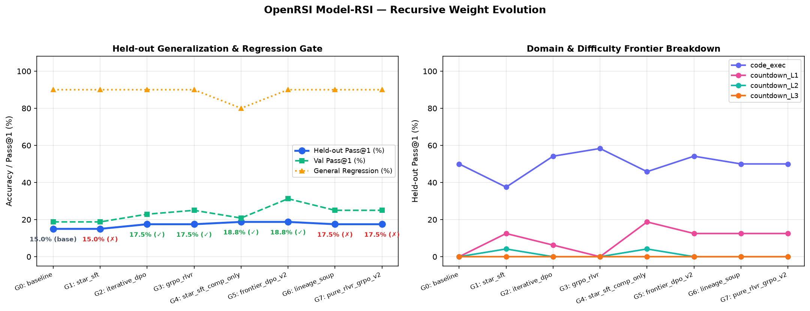

# Model-RSI（模型层自我进化）

[English](./README.md) | **中文** | [技术报告](./docs/TECHNICAL_REPORT_zh.md) | [← 返回 OpenRSI 首页](../README_zh.md)

**Model-RSI** 通过多代自动化闭环持续提升 AI 模型*自身的参数权重*。它不再单纯依赖人工标注数据，而是让模型自主采样解题或生成任务，通过沙盒中的自动验证器筛选出客观高质量信号，执行自动化后训练，并在严格通过留出测试集门控后晋升为新一代基座权重。

---

## 核心架构



### 核心模块

1. **采样与自博弈引擎（Rollout & Self-Play）**：基于当前 Checkpoint 生成多样化解题轨迹（也可叠加更强的 Harness 或推理时搜索来放大探索能力）。
2. **自动验证器（Automated Verifier）**：给出客观可验证的真实奖励，例如单元测试通过、代码编译执行成功、数学等价性校验等。
3. **数据与课程管理器（Data & Curriculum）**：动态控制任务难度（聚焦模型当前通过率既不是 0% 也不是 100% 的能力边界），去重并混入锚点数据防止遗忘。
4. **后训练执行器（Post-Training Runner）**：可插拔的训练后端，支持 LoRA 或全量参数的 SFT、DPO 以及在线强化学习（GRPO / PPO / RLVR）。
5. **晋升门控（Promotion Gate）**：在不可见的留出评测集与通用能力回归集上全面验分，只有真正变强才晋升为 `Checkpoint N + 1`。

---

## 核心进化范式

| 范式 | 工作方式 | 特点与权衡 |
| :--- | :--- | :--- |
| **拒绝采样 / STaR（验证 SFT）** | 对同一题采样多条轨迹，只保留验证通过的样本进行微调 | 实现简单、训练稳定、算力友好；对负样本利用不足 |
| **可验证强化学习（RLVR / GRPO / PPO）** | 直接依据沙盒验证奖励对分组采样轨迹进行策略优化 | 推理与编程能力上限最高；对奖励设计与训练稳定性要求高 |
| **迭代偏好优化（Iterative DPO）** | 将同一题下验证通过与失败的轨迹配成偏好对训练 | 能充分利用负样本信号，复杂度低于在线 RL |
| **Harness-to-Model 蒸馏** | 先用高算力的 `harness-rsi` 搜索与工具链攻克难题，再把验证通过的解蒸馏进模型权重 | 将昂贵的推理时搜索转化为模型自身的单步直觉 |
| **自博弈与前沿课程（Self-Play）** | 协同进化“出题器”与“解题器”，让训练任务始终紧贴模型当前能力边界 | 解决静态数据集见顶问题；但最难防止题目退化或失真 |

---

## 核心风险与护栏

用模型自生成数据进行多代递归训练，必须防范以下典型风险：

- **模型坍塌与多样性退化（Model Collapse）**：长期只在自产数据上训练会导致分布变窄。需要结合严格外部验证器、高多样性采样以及高质量锚点数据混合来缓解。
- **奖励黑客（Reward Hacking）**：模型可能学会钻验证器空子（如敷衍测试或迎合启发式规则）。验证器必须保持确定性、沙盒隔离，并接受留出集审计。
- **灾难性遗忘（Catastrophic Forgetting）**：窄领域自我强化可能损伤通用能力。晋升门控必须包含通用能力回归测试。
- **评测集污染（Contamination）**：采样任务池必须与留出评测集严格隔离。

---

## 实测结果（Colab NVIDIA GPU）

### 实验 3 & 4（Phase 4 & 4.2 双循环飞轮闭环 + Compactor/Reader 联合进化）：`Harness-RSI ↔ Model-RSI` × 官方 `CompactBench`

把 `harness-rsi` 产出的 48 个 Elite 案例（4,659 个官方确定性探针，按 `case_id` 严格 36/6/6 隔离切分，可通过 `uv run model-rsi audit-splits` 一键审计零泄漏）同时用于 **Reader 证据账本问答** 与 **`OpenRSICompactor v0.2.4` 原子补丁协议**（`A | H | KIND:` / `R n | H | KIND:` / `NO CHANGE` + Audit 审计轮）的蒸馏与难例纠偏，再通过 [HFCompactBenchProvider](./model_rsi/flywheel_provider.py) 反向接回官方 `compactbench==0.3.0` 完成全套消融实测：




- **Phase 4A（`Harness → Model`，249 个未见 32k Elite 官方探针）**：`53.15% (Gen 0) → 56.97% (Gen 1 蒸馏) → 59.28% (Gen 3 难例纠偏)`（**`+6.13%`**，满分探针 `127/249 → 141/249`，JSON 合规 `100%`，通用回归稳锁 `90.00%`；P0 瓶颈 `reference_resolution` **`52.78% → 67.50%` (+14.72%)**，P1 瓶颈 `conditional_scope` **`32.81% → 46.25%` (+13.44%)**）。
- **Phase 4.2（`Compactor + Reader` 双角色联合进化，Gen 4）**：新增严格 `train` 隔离的 322 条原子校验补丁/审计样本（[`compactbench_patch.py`](./model_rsi/tasks/compactbench_patch.py)）与 743 条 `buried_constraint` 多选精准度校准样本：
  - **Compactor 原子补丁通过率（`compactor_valid_patch_rate`）**：从 Raw 2B / Gen 3 的 **`0.00%`**（全部回退正则）跃升至 **`90.62%`（29/32 次真实原子补丁通过 `_apply_delta` 协议）**！
  - **官方 `starter/default`（102 探针）Cell 3（`Gen 4 + truncate-last-n`）**：**`56.20% → 58.26% → 61.55%`（`+5.35%` vs Raw 2B）**，抗漂移率 **`54.17% → 64.87%`（`+10.70%`）**！
  - **官方 `starter/default` Cell 4（`Gen 4 + OpenRSICompactor v0.2.4`）**：**`45.95% → 49.65% → 52.78%`（`+6.83%` vs Raw 2B + Harness）**，陈旧记忆错误率骤降 **`-20.00%`**（`53.33% → 33.33%`）！
  - **锁定 32k Elite 留出集（260 探针，`max_length=3584`）**：单阶段即达 **`58.44%`（`+5.29%`，JSON `100%`，回归 `90.00%`）**，其中瓶颈家族 **`buried_constraint` 从 `18.23% → 26.00%`（`+7.77%`）**、`decision_override` 达 **`84.48%`**、`provenance_authority` 达 **`84.78%`**。详见 [`reports/phase4_flywheel_report.md`](./reports/phase4_flywheel_report.md)。

### 实验 2（主力基座）：`Qwen/Qwen3.5-2B` × 开源成熟 RLVR 基准（`MATH-500` + `HumanEval+`）

训练集采用 `open-r1/Big-Math-RL-Verified-Processed`（L1–L2）+ `KodCode/KodCode-V1` + `MBPP`，门控评测严格锁定外部官方基准 **`HuggingFaceH4/MATH-500`**（40 题）+ **`evalplus/humanevalplus`**（40 题）+ 10 题通用防遗忘回归集：



| 世代 | 进化范式 | 门控结果 | Held-out Pass@1 | MATH-500 (留出) | HumanEval+ (留出) | Hard Val | 通用回归 |
| ---: | :--- | :--- | ---: | ---: | ---: | ---: | ---: |
| 0 | `baseline`（`Qwen/Qwen3.5-2B`） | baseline | 42.50% | 30.00% | 55.00% | 10.00% | 90.00% |
| 1 | `pure_rlvr_grpo`（`all-linear`） | rejected | 36.25% | 25.00% | 47.50% | 12.50% | 90.00% |
| 2 | `deltanet_safe_dpo`（冻结 `in_proj_a/b`） | **promoted** | 46.25% | 32.50% | **60.00%** | 10.00% | 90.00% |
| 3 | `deltanet_safe_grpo`（严格前沿 RLVR） | **promoted** | **48.75%** | **37.50%** | **60.00%** | **15.00%** | **90.00%** |

关键发现：冻结 Qwen3.5 Gated DeltaNet 的敏感递归状态门（`in_proj_a`/`in_proj_b`），仅在 Attention + MLP 层执行 **DeltaNet-Safe Iterative DPO → 严格前沿纯二值 RLVR（GRPO）**，让官方留出集总分提升 **`+6.25%`**（`42.50% → 48.75%`，其中 `MATH-500` `+7.50%`、`HumanEval+` `+5.00%`），同时通用回归锁定 **`90.00%`（零遗忘）**。详见 [`reports/qwen35_2b_experiment_summary.md`](./reports/qwen35_2b_experiment_summary.md)。

### 实验 1：`Qwen/Qwen2.5-1.5B-Instruct`（8 代 Countdown + MBPP）

我们在 Google Colab NVIDIA L4 GPU 上对开源权重 `Qwen/Qwen2.5-1.5B-Instruct` 完整跑通了 8 代（`Gen 0 → Gen 7`）Model-RSI 递归进化闭环，评测覆盖严格隔离的 **Countdown 可验证算术推理**（确定性 AST + 精确分数验证器）、**MBPP Sanitized Python 编程**（独立 `python -I` 子进程沙盒）以及 **10 题通用能力防遗忘回归门控**：



| 世代 | 进化范式 | 门控结果 | Held-out Pass@1 | Val Pass@1 | MBPP 代码 (留出) | Countdown L1 (留出) | 通用回归 |
| ---: | :--- | :--- | ---: | ---: | ---: | ---: | ---: |
| 0 | `baseline` | baseline | 15.00% | 18.75% | 50.00% | 0.00% | 90.00% |
| 1 | `star_sft`（全序列） | rejected | 15.00% | 18.75% | 37.50% | 12.50% | 90.00% |
| 2 | `iterative_dpo` | **promoted** | 17.50% | 22.92% | 54.17% | 6.25% | 90.00% |
| 3 | `grpo_rlvr` | **promoted** | 17.50% | 25.00% | **58.33%** | 0.00% | 90.00% |
| 4 | `star_sft_comp_only` | **promoted** | **18.75%** | 20.83% | 45.83% | **18.75%** | 80.00% |
| 5 | `frontier_dpo_v2` | **promoted** | **18.75%** | **31.25%** | 54.17% | 12.50% | **90.00%** |
| 6 | `lineage_soup` | rejected | 17.50% | 25.00% | 50.00% | 12.50% | 90.00% |
| 7 | `pure_rlvr_grpo_v2` | rejected | 17.50% | 25.00% | 50.00% | 12.50% | 90.00% |

完整诊断分析（包含 Gen 3 奖励黑客/长度坍塌发现与纯二值 RLVR 修复）见 [`reports/experiment_summary.md`](./reports/experiment_summary.md) 与 [`reports/evolution_history.json`](./reports/evolution_history.json)。

---

## 快速开始

```bash
cd model-rsi
uv run pytest -v                        # 运行 11 项确定性验证器、课程、门控、补丁与多轮自修复单测
uv run model-rsi audit-splits           # 一键审计 train / val / held_out / starter 零泄漏
uv run model-rsi export-patch-dataset   # 重建 322 条原子校验通过的 Compactor 补丁蒸馏集
uv run model-rsi status                 # 查看多代模型进化账本
uv run model-rsi plot                   # 生成 reports/evolution_curve.png
uv run model-rsi generate-tasks         # 导出严格隔离的 train/val/held_out/regression 任务集
uv run model-rsi import-harness         # 从 harness-rsi 导入已验证轨迹（M4 飞轮）
```

在 Google Colab GPU（T4 / L4 / A100）上复现全套端到端实验：
- `colab/run_model_rsi_colab.py` — 多代 Countdown / Math / Code RLVR 闭环
- `colab/run_phase4_flywheel.py` & `colab/run_phase42_coevolution.py` — 双循环飞轮 + Compactor/Reader 联合进化
- `colab/run_phase5_agentic_debug.py` — 多轮 Agentic 自我修复 RLVR（写代码 → 沙箱单测 → Traceback → Turn-2 修复）
- `colab/run_phase6_unified_rsi.py` — DeltaNet-Safe Task Arithmetic 统一多域融合与四基准联合评测

---

## 路线图（Roadmap）

- [x] **M1 — 统一轨迹与验证器协议**：标准化可验证轨迹（来自模型直采或 `harness-rsi`）的存储、打分与过滤格式（`model_rsi/protocol.py`、`model_rsi/tasks/`）。
- [x] **M2 — 验证 SFT / 拒绝采样闭环**：在开源模型上跑通端到端 Completion-Only STaR SFT 与 Iterative DPO 管线及自动留出集/回归门控（`model_rsi/trainers/star_sft.py`、`iterative_dpo.py`、`gating.py`）。
- [x] **M3 — 接入 RLVR（GRPO）**：提供面向代码与可验证推理任务的可插拔沙盒在线强化学习训练流，内置防奖励黑客纯二值验证奖励（`model_rsi/trainers/grpo_rlvr.py`）。
- [x] **M4 — 前沿课程与双循环飞轮（Phase 4 & 4.2）**：前沿难度调度（`curriculum.py`）、Compactor+Reader 联合进化（`compactbench_patch.py`，原子补丁通过率 `90.62%`）、官方 `HFCompactBenchProvider` 消融闭环与 [`harness-rsi`](../harness-rsi/README_zh.md) 只读蒸馏。
- [x] **M5 — 多轮 Agentic 自修复与统一多域融合底座（Phase 5 & 6）**：2 轮沙箱调试与 Traceback 自修复引擎（`model_rsi/tasks/agentic_debug.py`）、DeltaNet-Safe Task Arithmetic 融合器（`merge_task_arithmetic`）及全套 Colab 端到端脚本。
