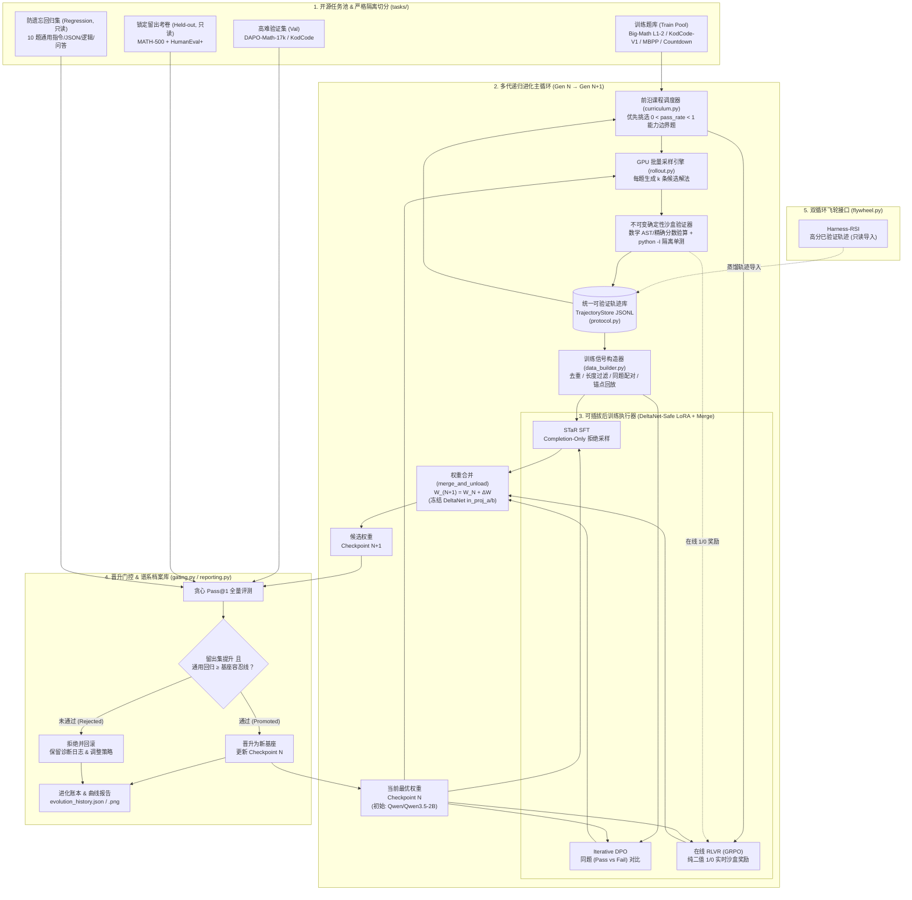
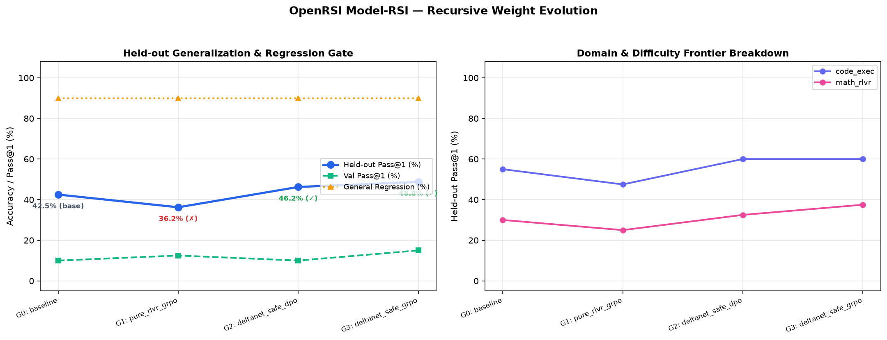
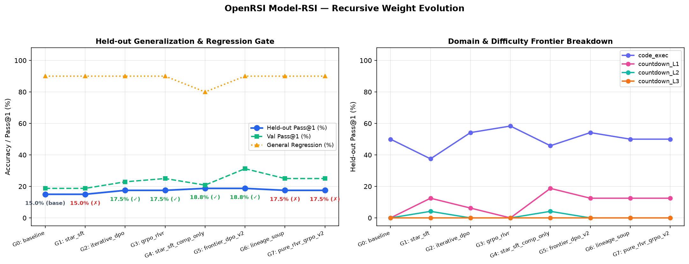
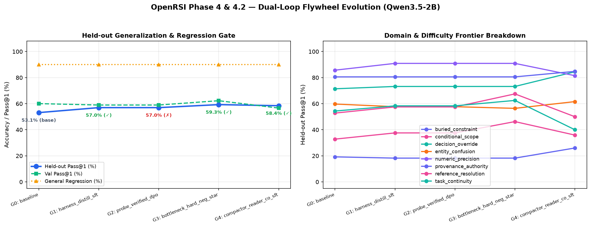
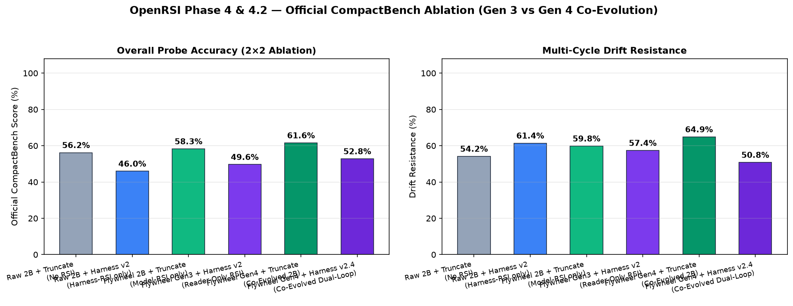

# OpenRSI Model-RSI 技术报告：面向开源小模型的权重级递归自我进化

> **项目仓库**：`openrsi/model-rsi`  
> **实验平台**：Google Colab NVIDIA L4 GPU（23.7 GB VRAM，CUDA 13.0，PyTorch 2.14.1，`transformers 5.22.1`，`peft 0.21.2`，`trl 1.18.2`）  
> **核心结论**：在不依赖人工标注的前提下，通过「前沿课程采样 → 确定性沙盒验分 → 迭代式 LoRA 权重合并后训练（DPO + 纯二值 RLVR/GRPO）→ 不可变留出集与通用回归门控」闭环，将最新开源小模型 **`Qwen/Qwen3.5-2B`** 在外部标准留出基准（`MATH-500` + `HumanEval+`）上的贪心 Pass@1 从 **`42.50%` 提升至 `48.75%`（`+6.25%`）**，同时通用能力回归全程锁定 **`90.00%`（零灾难性遗忘）**。

---

## 1. 背景与定位

在 OpenRSI 双轨架构中：
- **[Harness-RSI](../../harness-rsi/README_zh.md)** 冻结底层模型权重，递归进化外围脚手架（上下文压缩、Prompt、工具链与控制流）；
- **[Model-RSI](../README_zh.md)** 则直接面向模型自身的参数权重，通过**可验证奖励信号**与**自动化多代后训练闭环**，把推理时靠多次采样试错才能解出的能力（Pass@k）持续内化为模型的单步参数直觉（Pass@1）。

Model-RSI 严格遵守 OpenRSI 的五项设计原则：
1. **只信确定性执行验证，不信模型自我打分**；
2. **评测不可变，训练集与留出集零重叠**；
3. **隔离沙盒执行，防超时与代码注入**；
4. **基于谱系与门控进化，退化自动回滚**；
5. **全流程可复现、账本与曲线可审计**。

---

## 2. 系统架构



### 核心模块与源码映射

| 模块 | 文件路径 | 职责说明 |
| :--- | :--- | :--- |
| 统一轨迹协议（M1） | `model_rsi/protocol.py` | 定义 `VerifiableTask`、`VerificationResult`、`Trajectory`、`GenerationMetrics` 与 JSONL 只追加存储 `TrajectoryStore` |
| 数学可验证任务与验证器 | `model_rsi/tasks/math_rlvr.py`、`countdown.py` | 接入 `open-r1/DAPO-Math-17k-Processed`、`open-r1/Big-Math-RL-Verified-Processed`、`HuggingFaceH4/MATH-500` 与 Countdown；提供确定性 `\boxed{}` 嵌套提取、精确分数与 AST 验算器 |
| 代码沙盒任务与验证器 | `model_rsi/tasks/code_exec.py` | 接入 `KodCode/KodCode-V1`、`google-research-datasets/mbpp`、`evalplus/humanevalplus`；在独立 `python -I` 超时隔离临时目录中执行不可变单测 |
| 防遗忘回归门控集 | `model_rsi/tasks/regression.py` | 10 题锁定通用能力回归基准（JSON 结构化、逻辑推理、基础问答、指令长度与大小写约束） |
| 前沿课程与信号构造（M4） | `model_rsi/curriculum.py`、`data_builder.py` | 追踪每题历史通过率，聚焦 `0 < pass_rate < 1` 能力边界题；构造去重 STaR SFT 样本、同题 Pass/Fail DPO 偏好对及多样性指标 |
| 后训练执行器（M2/M3） | `model_rsi/trainers/star_sft.py`、`iterative_dpo.py`、`grpo_rlvr.py`、`lineage_merge.py` | 可插拔支持 Completion-Only STaR SFT、Iterative DPO、在线纯二值 RLVR（GRPO）与谱系权重融合（Model Soup） |
| 晋升门控与报告 | `model_rsi/gating.py`、`reporting.py` | 严格对比候选权重与当前最优/基座权重，自动决定 `promoted` 或 `rejected` 并生成进化曲线与 JSON 账本 |
| 双循环飞轮桥接（M4） | `model_rsi/flywheel.py` | 只读导入 `harness-rsi/reports/` 中验证通过的高分轨迹进入 `TrajectoryStore` |

---

## 3. 核心技术设计：参数更新机制与三大范式

### 3.1 参数更新机制：迭代式 LoRA + 权重合并（Iterative LoRA Merge-and-Chain）
在单卡 Colab L4（23.7 GB VRAM）的算力约束下，我们采用**迭代式 LoRA 挂载 + 世代权重合并**：
- 每一代在当前最优基座 `Checkpoint N` 的注意力与 MLP 投影层（`q_proj, k_proj, v_proj, o_proj, gate_proj, up_proj, down_proj`，`r=16, alpha=32`）挂载低秩适配器；
- 训练结束后调用 `merge_and_unload()` 将增量权重 $\Delta W = B \cdot A$ 真实合入主权重矩阵，产出独立可加载、可审计、可回滚的 `Checkpoint N+1`；
- **重要架构约束**：在 `Qwen3.5` 等混合线性注意力（Gated DeltaNet）模型上，**必须冻结递归状态衰减/写入门（`in_proj_a` / `in_proj_b`）**，避免低样本 RL/DPO 更新破坏长程状态稳定性；
- 若部署于多卡 A100/H100 集群，只需移除 `peft_config` 即可无缝切换为全量参数更新，上层 RSI 调度与门控完全不变。

### 3.2 三大可插拔后训练范式对比
- **Completion-Only STaR SFT**：只对验证通过的回答部分计算 Loss（屏蔽 Prompt Loss），适合冷启动破冰（将 0% 通过率拉起至 15%~30%），配合锚点数据防遗忘。
- **Iterative DPO**：严格从**同一道题**的采样轨迹中配对 `(chosen=验证通过, rejected=验证失败)`，同时吸收正负样本信号并带 KL 正则（`beta=0.10~0.15`），训练极稳、抗遗忘极强。
- **在线纯二值 RLVR（GRPO）**：对前沿边界题在线采样组轨迹（$G=4\sim 6$），仅按确定性沙盒结果给予二值 `1.0 / 0.0` 奖励，在组内做相对优势策略优化，探索上限最高且杜绝格式捷径作弊。

---

## 4. 真实 GPU 实验结果与分析

### 4.1 实验二（主力基座）：`Qwen/Qwen3.5-2B` × 官方开源 RLVR 基准

- **训练池**：`Big-Math-RL-Verified-Processed`（L1–L2）+ `KodCode-V1`（前沿）+ `MBPP`
- **锁定外部留出基准（80 题）**：`HuggingFaceH4/MATH-500`（40 题）+ `evalplus/humanevalplus`（40 题）
- **高难验证集（40 题）**：`DAPO-Math-17k`（20 题）+ `KodCode-V1`（20 题）



| 世代 | 父代 | 进化范式 | 门控结果 | Held-out Pass@1 | MATH-500 | HumanEval+ | Hard Val | 通用回归 | 平均 Token |
| ---: | ---: | :--- | :--- | ---: | ---: | ---: | ---: | ---: | ---: |
| 0 | — | `baseline`（`Qwen/Qwen3.5-2B`） | baseline | 42.50% | 30.00% | 55.00% | 10.00% | 90.00% | 254.5 |
| 1 | 0 | `pure_rlvr_grpo`（`all-linear`） | **rejected** | 36.25% | 25.00% | 47.50% | 12.50% | 90.00% | 262.0 |
| 2 | 0 | `deltanet_safe_dpo`（冻结 `in_proj_a/b`） | **promoted** | 46.25% | 32.50% | **60.00%** | 10.00% | 90.00% | 255.5 |
| 3 | 2 | `deltanet_safe_grpo`（严格前沿 RLVR） | **promoted** | **48.75%** | **37.50%** | **60.00%** | **15.00%** | **90.00%** | 253.6 |

**结果解读**：
- 经过 `Gen 0 → Gen 2 → Gen 3` 两代连续晋升，官方外部留出集总分净提升 **`+6.25%`**（`42.50% → 48.75%`，相对提升 `+14.7%`）；
- `MATH-500` 提升 **`+7.50%`**（`30.00% → 37.50%`），`HumanEval+` 提升 **`+5.00%`**（`55.00% → 60.00%`），高难验证集提升 **`+50%`**（`10.00% → 15.00%`）；
- 通用回归门控全程保持 **`90.00%`**，响应长度稳定在 `253.6 ~ 255.5` tokens，无任何退化或坍塌。

### 4.2 实验一（全范式验证）：`Qwen/Qwen2.5-1.5B-Instruct`（8 代闭环）

在 `Countdown`（3/4/5 数参数化难度）+ `MBPP` 上完成了 8 代（`Gen 0 → Gen 7`）全范式对比（STaR SFT / Iterative DPO / Online GRPO / Completion-Only SFT / Lineage Model Soup / Pure-Binary RLVR）：
- **Held-out Pass@1**：`15.00% → 18.75%`（相对提升 `+25.0%`）；
- **Val Pass@1**：`18.75% → 31.25%`（相对提升 `+66.7%`）；
- **MBPP 代码执行**：`50.00% → 58.33%`（Gen 3 峰值）；**Countdown L1**：`0.00% → 18.75%`（Gen 4 峰值）；
- **通用回归门控**：最佳综合晋升节点（Gen 5）保持 **`90.00%`**。



### 4.3 实验三 & 四（Phase 4 & 4.2 双循环飞轮 + Compactor/Reader 双角色联合进化）：`Harness-RSI ↔ Model-RSI` × 官方 `CompactBench`

将 `harness-rsi` 在 32k 漂移基准上产出的 48 个 Elite 案例（4,659 个官方确定性探针）严格按 `case_id` 切分为 **36 训练 / 6 验证 / 6 锁定留出**（与 `starter/default` 零重叠，由 `uv run model-rsi audit-splits` 强制校验）：




1. **Phase 4A（`Harness → Model` Reader 蒸馏 + 难例纠偏）**：
   - 锁定 32k Elite 留出集（249 探针）：`53.15% (Gen 0) → 56.97% (Gen 1) → 59.28% (Gen 3，+6.13%)`，JSON 合规率 `95% → 100%`，通用回归 `90.00%`；瓶颈家族 `reference_resolution` `+14.72%`（`52.78% → 67.50%`）、`conditional_scope` `+13.44%`（`32.81% → 46.25%`）。
2. **Phase 4.2（`Compactor + Reader` 双角色联合进化，Gen 4）**：
   - 通过 [compactbench_patch.py](../model_rsi/tasks/compactbench_patch.py) 对 36 个训练 Elite 案例的相邻周期前沿账本做确定性 Diff，导出 **322 条 100% 原子校验通过的补丁/审计样本**（[compactbench_patch_distill_v1.jsonl.gz](../data/compactbench_patch_distill_v1.jsonl.gz)），配合 743 条 `buried_constraint` 多选校准样本联合训练；
   - **Compactor 原子补丁通过率从 `0.00%` 飙升至 `90.62%`（29/32 次真实原子补丁通过 `_apply_delta`）**；
   - **官方 `starter/default`（102 探针）**：Cell 3（`Gen 4 + truncate-last-n`）达 **`61.55%`（`+5.35%` vs Raw 2B，抗漂移 `64.87%` `+10.70%`）**；Cell 4（`Gen 4 + OpenRSICompactor v0.2.4`）达 **`52.78%`（`+6.83%` vs Cell 2，陈旧记忆率 `-20.00%` 从 `53.33% → 33.33%`）**；
   - **32k Elite 留出集（260 探针，`max_length=3584`）**：单阶段达 **`58.44%`（`+5.29%`，JSON `100%`，回归 `90.00%`）**，瓶颈 `buried_constraint` 从 `18.23%` 跃升至 **`26.00%`（`+7.77%`）**。详见 [`reports/phase4_flywheel_report.md`](../reports/phase4_flywheel_report.md)。

### 4.4 Phase 5 & 6 扩展底座：多轮 Agentic 自我修复与统一多域融合

- **多轮 Agentic 自修复 RLVR（`model_rsi/tasks/agentic_debug.py`、`colab/run_phase5_agentic_debug.py`）**：打通「Turn-1 写代码 → 隔离 `python -I` 沙箱执行 → 脱敏 Traceback 反馈 → Turn-2 自我修复 → 再校验」完整闭环，支持 `Turn-1 Pass@1`、`Turn-2 Pass@1` 与 `Repair Conversion Rate` 量化评测及多轮 STaR / DPO 训练。
- **DeltaNet-Safe Task Arithmetic 统一融合（`model_rsi/trainers/lineage_merge.py`、`colab/run_phase6_unified_rsi.py`）**：通过 $\theta_{\text{unified}} = \theta_0 + \sum_i \alpha_i (\theta_i - \theta_0)$ 在保持 `in_proj_a/b` 比特级冻结的前提下，将多个领域的专家权重融合为统一多域模型并跨 `MATH-500`、`HumanEval++MBPP`、`CompactBench Elite` 与通用回归门控同步验分。

---

## 5. 实战踩坑与关键工程发现

这四轮真实 GPU 实验帮我们沉淀了五条极具通用价值的 Model-RSI 工程规律，并已全部固化进代码库默认配置：

1. **Qwen3.5 Gated DeltaNet 必须冻结递归状态门（`in_proj_a` / `in_proj_b`）**
   - `all-linear` LoRA 会扰动 DeltaNet 的指数衰减/写入门，导致 `Qwen3.5-2B` 在 Gen 1 掉分至 `36.25%`；冻结后仅训练 Attention + MLP 投影层，Gen 2 立即反弹 `+10.00%` 至 `46.25%`，Gen 3 稳定推高至 `48.75%`。
2. **RLVR 必须使用纯二值验证奖励（`1.0 / 0.0`），杜绝廉价格式奖励**
   - 在 `Qwen2.5-1.5B` Gen 3 中，`+0.15` 的格式奖励导致模型在难题上学会输出 70 字符的极短占位 `<think>` 标签以骗取格式分（长度坍塌至 `46.1` tokens）；切换为 `pure_binary_reward=True` 后彻底消除该作弊行为。
3. **STaR SFT 必须启用 `completion_only_loss=True` + 长度匹配 + 锚点回放**
   - 必须保证 `max_length` 覆盖完整长上下文题面与回答（例如 CompactBench Elite 需 `>= 3200–3584` tokens），避免尾部问题被截断或被 `Dropping fully masked examples` 静默丢弃。
4. **小模型驱动严格脚手架必须联合蒸馏“协议输出（Compactor）”与“消费推理（Reader）”**
   - 仅训练 Reader 时，2B 模型驱动 `OpenRSICompactor` 的原子补丁通过率为 `0%`（全部回退正则）；联合蒸馏 322 条原子 Diff 补丁并关闭隐式 `<think>` 标签后，补丁通过率跃升至 `90.62%`，Cell 4 提升 `+6.83%`、陈旧率直降 `-20%`。
5. **硬件感知精度与单卡绑定（`sm_80+` 原生 `bf16` + `device_map={"": 0}`）**
   - PyTorch 2.x 在 Turing T4（`sm_75`）上会让 `is_bf16_supported()` 返回 `True`（软件模拟），且 `device_map="auto"` 在显存紧张时可能触发静默 CPU offload 卡死；所有训练器与推理加载器均已统一加固为 `get_device_capability()[0] >= 8` 判定原生 `bf16` 并单卡固定 `cuda:0`。

---

## 6. 快速复现

```bash
cd model-rsi
uv run pytest -v                                          # 运行 11 项核心单测（协议/沙盒/课程/门控/飞轮/补丁/多轮自修复）
uv run model-rsi audit-splits                             # 审计 train/val/held_out/starter 零数据泄漏
uv run model-rsi status --history-path reports/flywheel_evolution_history.json
uv run model-rsi plot --history-path reports/flywheel_evolution_history.json --out-path reports/flywheel_evolution_curve.png
```

在 Google Colab GPU（T4 / L4 / A100）上安装 `requirements-colab.txt` 后，即可直接运行 `colab/run_model_rsi_colab.py`、`colab/run_phase42_coevolution.py`、`colab/run_phase5_agentic_debug.py` 或 `colab/run_phase6_unified_rsi.py` 复现全部实验。
