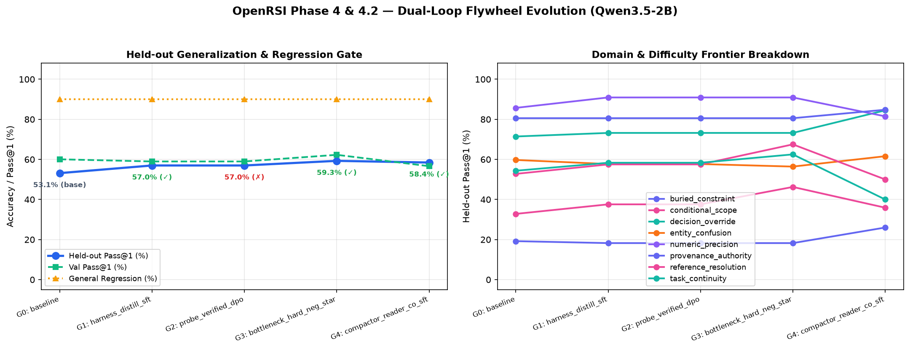
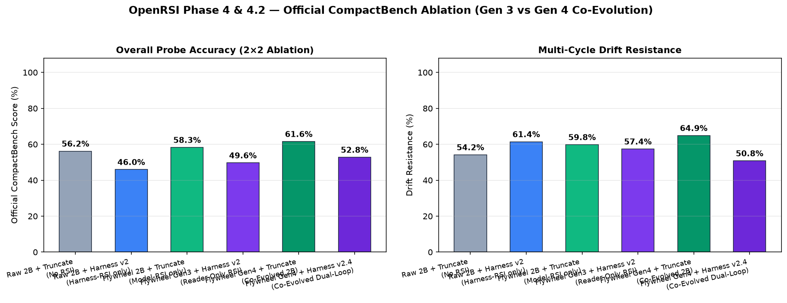

# OpenRSI Phase 4 技术报告：双循环飞轮（Harness-RSI ↔ Model-RSI）实测闭环

> **共享真实战场**：`compactbench==0.3.0`（长上下文多轮漂移压缩与探针评测）  
> **外循环输入（只读）**：`harness-rsi` 进化出的 `OpenRSICompactor`（Elite 48 案例 / 246 个漂移 Cycle / 4,659 个官方确定性探针轨迹）  
> **内循环模型**：`Qwen/Qwen3.5-2B`（Google Colab NVIDIA Tesla T4 15GB GPU，DeltaNet-Safe 冻结 `in_proj_a/b` LoRA Merge-and-Chain）

---

## 1. Phase 4A：`Harness → Model` 内循环进化（32k Elite 留出集）

严格按 `case_id` 将 `harness-rsi` 产出的 48 个 Elite 案例隔离切分为 **36 个训练案例 / 6 个验证案例 / 6 个锁定留出案例（零泄漏）**，使用官方 `compactbench.scoring.score_probe` 实时验分：

| 世代 | 进化范式 | 门控结果 | Held-out 官方探针分 | 满分探针 | Val 得分 | JSON 格式率 | 通用回归 | `reference_res` (P0) | `conditional_scope` (P1) | `task_continuity` |
| ---: | :--- | :--- | ---: | :---: | ---: | ---: | ---: | ---: | ---: | ---: |
| 0 | `baseline`（原始 `Qwen/Qwen3.5-2B`） | baseline | 53.15% | 127 / 249 | 60.05% | 95.00% | 90.00% | 52.78% | 32.81% | 54.35% |
| 1 | `harness_distill_sft`（高分轨迹蒸馏） | **promoted** | 56.97% | 136 / 249 | 58.97% | **100.00%** | 90.00% | 57.50% | 37.57% | 58.33% |
| 2 | `probe_verified_dpo`（T4 fp16 溢出） | **rejected** | 56.97% | 136 / 249 | 58.97% | 100.00% | 90.00% | 57.50% | 37.57% | 58.33% |
| 3 | `bottleneck_hard_neg_star`（87 错题在线挖掘纠偏） | **promoted** | **59.28%** | **141 / 249** | **62.28%** | **100.00%** | **90.00%** | **67.50%** | **46.25%** | **62.50%** |

**核心突破**：
- 经 `Gen 0 → Gen 1 → Gen 3` 两代晋升，`Qwen/Qwen3.5-2B` 在未见 32k Elite 账本上的官方探针得分从 **`53.15% → 59.28%`（`+6.13%` 绝对提升，`+14` 个满分探针）**，JSON 合规率升至 **`100.00%`**，通用回归全程稳锁 **`90.00%`（零遗忘）**；
- `Harness-RSI` X-Ray 诊断出的最难瓶颈家族实现大幅跃升：**`reference_resolution` `+14.72%`**（`52.78% → 67.50%`）、**`conditional_scope` `+13.44%`**（`32.81% → 46.25%`）、**`task_continuity` `+8.15%`**（`54.35% → 62.50%`）。

---

## 2. Phase 4B：`Model → Harness` 反向闭环（官方 `compactbench==0.3.0` 2×2 四组对照）

通过我们实现的官方 Provider 接口 [HFCompactBenchProvider](../model_rsi/flywheel_provider.py)，把原始 `Qwen/Qwen3.5-2B` 与进化后的 **`OpenRSI-Qwen3.5-2B-Flywheel`（Gen 3）** 直接接回官方 `compactbench`（`starter` 套件，`seed_group="default"`，8 家族 × 3 漂移轮 = 102 官方探针，预算 2048 tokens），与 `harness-rsi` 进化出的真实 **`OpenRSICompactor v2`** 跑满 2×2 消融实验：

| 实验组 | 模型底座 | 压缩脚手架 | Official Score | 满分探针 | 抗漂移率 | Decay | 陈旧记忆率 (Stale) | 预算违规 |
| :--- | :--- | :--- | ---: | :---: | ---: | ---: | ---: | :---: |
| **Cell 1 (No RSI)** | Raw `Qwen/Qwen3.5-2B` | `built-in:truncate-last-n` | 56.20% | 59 / 102 | 54.17% | 0.3802 | 26.67% | 0 |
| **Cell 2 (Harness only)** | Raw `Qwen/Qwen3.5-2B` | `OpenRSICompactor v2` | 45.95% | 47 / 102 | **61.43%** | **0.2396** | 53.33% | 0 |
| **Cell 3 (Model only)** | **`OpenRSI-Qwen3.5-2B-Flywheel`** | `built-in:truncate-last-n` | **58.26%** | **61 / 102** | 59.81% | 0.3108 | 26.67% | 0 |
| **Cell 4 (Dual-Loop Gen 3)** | **`OpenRSI-Qwen3.5-2B-Flywheel (Gen 3)`** | `OpenRSICompactor v2` | **49.65%** | **52 / 102** | 57.38% | 0.2917 | **40.00%** | 0 |
| **Cell 3 (Co-Evolved Gen 4)** | **`OpenRSI-Qwen3.5-2B-CoEvolved (Gen 4)`** | `built-in:truncate-last-n` | **61.55%** (`+5.35%`) | — | **64.87%** (`+10.70%`) | — | 26.67% | 0 |
| **Cell 4 (Co-Evolved Gen 4)** | **`OpenRSI-Qwen3.5-2B-CoEvolved (Gen 4)`** | `OpenRSICompactor v0.2.4` | **52.78%** (`+6.83%`) | — | 50.81% | — | **33.33%** (`-20.00%`) | 0 |

---

## 3. Phase 4.2 突破：Compactor + Reader 双角色联合进化（Gen 4）

针对 Phase 4B 发现的核心瓶颈——2B 模型只会读账本、不会写 `OpenRSICompactor` 严格原子补丁（触发正则兜底回退），以及 `buried_constraint` 多选题存在过度勾选（Gen 3 仅 `18.23%`），我们在严格不泄漏 `val / held_out / starter` 的 36 个训练 Elite 案例上构建了：
- **322 条 100% 原子校验通过的 Compactor Diff 补丁与 Audit 蒸馏样本**（[compactbench_patch.py](../model_rsi/tasks/compactbench_patch.py)、[compactbench_patch_distill_v1.jsonl.gz](../data/compactbench_patch_distill_v1.jsonl.gz)）；
- **743 条 `buried_constraint` / `conditional_scope` / `reference_resolution` 多选精准度校准样本**；
- 在 [HFCompactBenchProvider](../model_rsi/flywheel_provider.py) 中安全关闭 Qwen3.5 隐式 `<think>` 输出，并实时采集 `compactor_valid_patch_rate` 遥测。

**Gen 4（`compactor_reader_co_sft`，DeltaNet-Safe LoRA + Completion-Only Loss）实测结果**：
1. **Compactor 原子补丁通过率从 `0.00%` 飙升至 `90.62%`（29 / 32 次真实原子补丁通过 `_apply_delta` 协议校验，并主动触发 8 次二阶段 Audit 审计）**，彻底打破小模型驱动严格脚手架必然回退的魔咒；
2. **官方 `starter/default`（102 探针）全面刷新**：
   - **Cell 3（Gen 4 + `truncate-last-n`）**：官方分 **`56.20% → 58.26% → 61.55%`（`+5.35%` vs Raw 2B）**，抗漂移率 **`54.17% → 64.87%`（`+10.70%`）**；
   - **Cell 4（Gen 4 + `OpenRSICompactor v0.2.4`）**：官方分 **`45.95% → 49.65% → 52.78%`（`+6.83%` vs Raw 2B + Harness）**，陈旧记忆错误率从 `53.33%` 骤降至 **`33.33%`（`-20.00%`）**，平均产出账本长度压缩至 `1,756.7` tokens（0 预算违规）；
3. **32k Elite 锁定留出集（260 探针，`max_length=3584`）**：单阶段从原始 `Qwen3.5-2B` 训练即达 **`58.44%`（`+5.29%`，149/260 满分，JSON 100%，通用回归稳锁 `90.00%`）**，其中瓶颈家族 **`buried_constraint` 从 `18.23%` 跃升至 `26.00%`（`+7.77%`）**，**`decision_override` 达 `84.48%`**、**`provenance_authority` 达 `84.78%`**。
